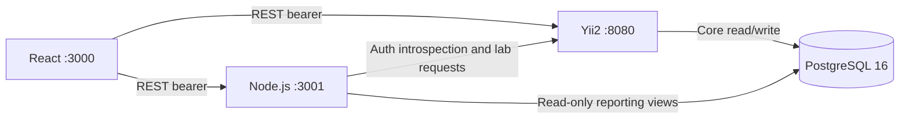

# SIMRS Outpatient — Integrated outpatient care

**PT Inova Medika Solusindo · Senior Programmer real case test**  
**v1.1.0 — Final QA & Release candidate; runtime verification pending**

A local demonstration of integrated outpatient care: master data → registration/queue → clinical record/procedures → pharmacy/laboratory → invoice/payment → operational reporting. Six role-specific workspaces; Premium Healthcare SaaS (white sidebar, teal, spacious). Dummy data only. No production deployment or payment gateway.

## Release status

Source covers the nine functional modules and six technical scenarios. The preceding v1.0.0 was built and tested on the MacBook during UAT (user-provided isolated QA log and screenshots); v1.0.1 through v1.1.0 changes have not been runtime-tested. Dependency-free regression results for this release are in [v1.1.0 static evidence](docs/evidence/v1.1.0-static-checks.txt). See [v1.1.0 release notes](docs/V1.1.0_NOTES.md), [v1.0.4 release notes](docs/V1.0.4_NOTES.md), [v1.0.3 release notes](docs/V1.0.3_NOTES.md), [v1.0.2 release notes](docs/V1.0.2_NOTES.md), [v1.0.1 release notes](docs/V1.0.1_NOTES.md), [UAT backlog](docs/UAT_BACKLOG.md) and [submission gate](docs/SUBMISSION_CHECKLIST.md). Postman execution and release regression evidence remain outstanding.

## Architecture



Yii2 is the sole writer of business data. Node validates/integrates lab requests and aggregates reports; it cannot write domain tables. PostgreSQL owns transactional state. React is not authoritative for stock, prices, status or permissions. [Architecture](docs/ARCHITECTURE.md) · [ERD](docs/ERD.md) · [Technical decisions](docs/TECHNICAL_DECISIONS.md).

## Quick start (macOS / Apple Silicon target)

Install and start Docker Desktop (Compose v2), Python 3.9+, Git; internet for first image/package resolution. Free ports 3000, 3001, 8080. Extract ZIP, `cd simrs-outpatient`.

**Recommended first: isolated QA with a retained dummy environment** (does not use your normal database):

```bash
python3 scripts/qa-runtime.py --dry-run --outage
python3 scripts/qa-runtime.py --outage --keep
```

The runner prints an isolated workdir and cleanup command; use the printed workdir for its `.env` and demo prefix. Logs/summary are in `qa-results/` in the original project. Do not start a second stack on the same ports. Without `--keep`, only the isolated QA stack is removed. See [testing](docs/TESTING.md).

**Alternatively run the ordinary local demo:**

```bash
./scripts/setup-env.sh
docker compose config --quiet
docker compose up --build -d
docker compose ps -a
docker compose logs migrate
```

`migrate` should exit 0 after applying all four Yii migrations and seed. Open [frontend](http://localhost:3000), [Core health](http://localhost:8080/api/v1/health), [Node health](http://localhost:3001/api/v1/health). Use localhost, not a different browser origin; PostgreSQL is internal only. Never manually apply schema.sql in addition to migrations.

| Username | Password pattern | Landing |
|---|---|---|
| admin | `<prefix>-admin` | /dashboard |
| registration | `<prefix>-registration` | /registration |
| doctor | `<prefix>-doctor` | /doctor |
| pharmacy | `<prefix>-pharmacy` | /pharmacy |
| laboratory | `<prefix>-laboratory` | /laboratory |
| cashier | `<prefix>-cashier` | /billing |

`grep '^DEMO_PASSWORD_PREFIX=' .env` locally (in the retained QA workdir if applicable). Keep this secret out of screenshots, logs and Git. Seed does not overwrite existing accounts. Bearer token lives in memory; a scoped HttpOnly cookie restores the same unexpired session after refresh. There is no sliding expiry or long-lived refresh token. Logout revokes tokens for the authenticated user; a mismatched newer cookie from another account is preserved. Browser generation markers coordinate tabs (not credentials); if the server is unreachable, revocation is not confirmed. Use separate browser profiles for separate simultaneous role sessions.

## Updating an existing UAT database

Follow [the cumulative non-destructive upgrade guide](docs/UPGRADE_V1.1.0.md) and [targeted release UAT](docs/FINAL_UAT.md). Only the v1.0.1 migration 000004 is new relative to v1.0.0; do not reseed existing data. Keep the original `.env`, Compose project name and volume. Do not run `down -v`, reset seed data or blindly replace locally patched files.

## Run and evaluate

1. [Demo walkthrough](docs/DEMO_WALKTHROUGH.md): one fresh dummy visit, four charge categories, partial and final payment, dashboard.
2. [Testing guide](docs/TESTING.md): policy checks, isolated integration runner, database invariants, Postman, query plans and manual QA.
3. [Postman guide](postman/README.md): import environment, end-to-end workflow collection and focused collections. Actual Postman evidence must be captured locally.
4. [Submission checklist](docs/SUBMISSION_CHECKLIST.md) and [Git guide](docs/GITHUB_SETUP.md): capture authentic evidence, scrub secrets, publish accessible repository and submit.

## Repository map

| Path | Purpose |
|---|---|
| frontend/ | React + TypeScript, Ant Design theme, protected workspaces |
| backend-yii/ | Yii2 REST core, services, policies, migrations and PHP tests |
| backend-node/ | Express REST integration/reporting, Zod/auth middleware |
| database/ | Baseline schema and init permissions |
| scripts/ | Static checks, integration tests, isolated QA runner |
| postman/ | API collections and local environment template |
| docs/ | Technical documentation, traceability, QA and actual static logs |

## Documentation index

[Assignment traceability](docs/TRACEABILITY.md) · [Requirements](docs/REQUIREMENTS.md) · [REST API](docs/API.md) · [RBAC](docs/RBAC.md) · [Workflow](docs/WORKFLOW.md) · [Database/ERD](docs/ERD.md) · [Design specification](docs/UI_UX_SPECIFICATION.md) · [Test cases](docs/TEST_CASES.md) · [Interview guide](docs/INTERVIEW_GUIDE.md) · [Release notes](docs/PHASE10_NOTES.md).

## Troubleshooting and dependency reproducibility

```bash
docker compose ps -a
docker compose logs --tail=100 db migrate yii node frontend
```

Keep original `.env` and volume when upgrading. For an existing UAT database use the migration-only command and no-deps startup in the upgrade guide; do not run the default migrate+seed command. Normal stop: `docker compose down` (retains DB). **Never use `down -v` on data you need.** Use the runner's explicit isolated cleanup command only for its dummy project.

No package lockfiles were available from prior phases. Resolve them locally using `npm install` in both JS projects and `composer install` in backend-yii (PHP 8.3 plus required extensions); commit actual lockfiles, switch npm Dockerfiles to `npm ci`, rebuild and rerun tests. Review `npm audit` and `composer audit`; do not blindly force upgrades. No vulnerability scan or dependency build is claimed here. No actual Git remote or deployment has been created. Do not use real patient or payment data.

## Final Runtime Verification

Release: v1.1.0
Test date: 25 November 2026
Environment: macOS, Apple Silicon M1, Docker Compose, PostgreSQL 16

| Verification | Result |
|---|---|
| Docker production build | PASS |
| Database migration | PASS |
| Existing database preservation | 23 tables verified |
| Targeted browser UAT | 7/7 groups PASS |
| Automated integration testing | 844 HTTP checks PASS |
| PHP policy regression | 656 assertions PASS |
| Static regression | 1,554 assertions PASS |
| Postman Collection via Newman | 51/51 requests PASS |
| Newman assertions | 133/133 PASS |
| Database invariants | 10/10 PASS |
| Node.js outage and recovery | PASS |
| Migration rollback and reapply | PASS |

### Evidence

- [Final runtime evidence](docs/evidence/FINAL_RUNTIME_EVIDENCE.md)
- [Application screenshots](docs/evidence/screenshots/)
- [Invoice and payment receipts](docs/evidence/billing/)
- [Automated integration results](docs/evidence/automated-qa/)
- [Postman execution summary](docs/evidence/postman/newman-summary.txt)
- [Newman JSON report](docs/evidence/postman/newman-result.json)

### Known Limitations

- All patient data and payments are simulated.
- Payments do not use a real payment gateway.
- Registration supports same-day visits.
- Future booking and practice-hour warnings are deferred.
- Performance checks use a small dummy dataset, not production-scale load testing.
- This release has not undergone an independent security audit.
- Clinical JSONB persistence retains the runtime-verified Yii JsonExpression implementation.

