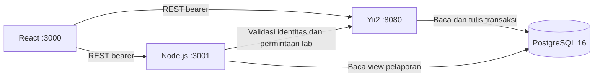

# SIMRS Rawat Jalan Terintegrasi

**Versi 1.1.0 — Hasil verifikasi lokal, 25 November 2026 (WIB)**

Sistem Informasi Manajemen Rumah Sakit (SIMRS) untuk simulasi pelayanan rawat jalan terintegrasi. Aplikasi menghubungkan pengelolaan data master, pendaftaran dan antrean, rekam medis elektronik, tindakan medis, farmasi, laboratorium, penerbitan tagihan, pembayaran, dan pelaporan operasional. Dikembangkan sebagai real case test posisi Senior Programmer PT Inova Medika Solusindo. Seluruh pasien, hasil klinis, dan pembayaran merupakan data dummy. Aplikasi tidak digunakan untuk pelayanan medis nyata.


## Fitur utama

| Modul | Kemampuan |
|---|---|
| Data master | Pasien, tenaga medis, poli, jadwal dokter, tindakan, obat dan stok, pemeriksaan laboratorium; kode otomatis dan pengelolaan status. |
| Pendaftaran | Pencarian pasien, jadwal aktif, antrean harian per poli, pencegahan duplikasi. |
| Rekam medis | Ruang kerja dokter dengan lima tahapan, riwayat klinis, validasi, optimistic locking dan alasan perubahan. |
| Tindakan medis | Beberapa tindakan, kuantitas, tarif tersimpan dan revisi biaya sebelum pembayaran. |
| Farmasi | Resep, pemeriksaan stok, penyerahan atomik dan riwayat mutasi. |
| Laboratorium | Permintaan, pencatatan hasil dan integrasi REST melalui Node.js dengan idempotency. |
| Tagihan dan pembayaran | Invoice otomatis, pembayaran bertahap, pencegahan pembayaran ganda, bukti pembayaran individual dan cetak A4. |
| Pelaporan | Grafik kunjungan dan penerimaan, ringkasan tagihan, status pembayaran, rincian berdasarkan periode. |
| Hak akses | Enam peran pengguna, sesi browser, pengelolaan akun, audit aktivitas. |

## Arsitektur dan teknologi



Frontend: React, TypeScript, Vite, Ant Design, TanStack Query, React Router, Axios. Backend utama: PHP 8.3 dan Yii2. Layanan pendukung: Node.js 22, Express, TypeScript, Zod. Basis data: PostgreSQL 16. Infrastruktur lokal: Docker Compose. Yii2 merupakan satu-satunya layanan yang menulis data bisnis; Node.js memvalidasi dan meneruskan hasil lab serta membaca view pelaporan dengan hak akses terbatas. Nilai tarif, stok, status dan otorisasi ditentukan server.

## Instalasi lokal

Siapkan Docker Desktop (Compose v2 atau kompatibel), Git dan Python 3.9+. Koneksi internet dibutuhkan untuk pengunduhan image dan dependency pertama. Pastikan port 3000, 3001 dan 8080 tersedia. Clone repository ini atau ekstrak paket source, lalu masuk ke direktori `simrs-outpatient`.

```bash
bash scripts/setup-env.sh
docker compose config --quiet
docker compose up --build -d
docker compose ps -a
docker compose logs migrate
```

Layanan `migrate` pada instalasi baru harus selesai dengan kode 0 setelah menerapkan empat migration Yii dan mengisi data dummy. Jangan menjalankan `database/schema.sql` secara terpisah setelah migration. Gunakan alamat `localhost` agar origin browser sesuai konfigurasi.

| Layanan | Alamat |
|---|---|
| Aplikasi | http://localhost:3000 |
| Kesehatan Yii2 | http://localhost:8080/api/v1/health |
| Kesehatan Node.js | http://localhost:3001/api/v1/health |
| PostgreSQL | Port 5432 internal Docker, tidak dipublikasikan |

## Akun demonstrasi

Lihat awalan kata sandi yang dihasilkan secara lokal:

```bash
grep '^DEMO_PASSWORD_PREFIX=' .env
```

| Nama pengguna | Pola kata sandi | Halaman awal |
|---|---|---|
| `admin` | `<prefix>-admin` | `/dashboard` |
| `registration` | `<prefix>-registration` | `/registration` |
| `doctor` | `<prefix>-doctor` | `/doctor` |
| `pharmacy` | `<prefix>-pharmacy` | `/pharmacy` |
| `laboratory` | `<prefix>-laboratory` | `/laboratory` |
| `cashier` | `<prefix>-cashier` | `/billing` |

Ganti `<prefix>` dengan nilai lokal tanpa tanda kurung sudut. Jangan membagikan `.env`, awalan kata sandi atau JWT. Seed tidak menimpa akun yang sudah ada. Token berada di memori; cookie HttpOnly memulihkan sesi yang sama selama belum kedaluwarsa. Logout mencabut sesi akun tersebut melalui `token_version`; tidak ada refresh token jangka panjang. Gunakan profil browser berbeda untuk menjalankan beberapa peran secara bersamaan.

## Demonstrasi dan hasil pengujian

Alur utama: pendaftaran → pemeriksaan dokter → laboratorium/farmasi → invoice → pembayaran sebagian → lunas → pelaporan. Lihat [panduan demonstrasi](docs/DEMO_WALKTHROUGH.md).

Pengujian aktual dilakukan pada MacBook Apple Silicon M1, Docker Compose dan PostgreSQL 16 tanggal 25 November 2026. Source aktual mempertahankan perbaikan lokal `Yii\db\JsonExpression` untuk JSONB.

| Pemeriksaan | Hasil |
|---|---|
| Build seluruh layanan Docker dan pengujian paket React/Node.js | Lulus |
| Migration 000004 dan fingerprint 23 tabel bisnis | Lulus; identik sebelum/sesudah |
| UAT terarah | 7/7 kelompok alur utama lulus berdasarkan bukti dan konfirmasi pengguna |
| Pengujian integrasi HTTP terisolasi | 844 pemeriksaan lulus |
| Pengujian kebijakan PHP | 656 assertion lulus |
| Regression statis | 1.554 assertion lulus (termasuk PHP) |
| Postman Collection melalui Newman | 51/51 request, 133/133 assertion; exit code 0 |
| Invariant basis data | 10/10 sebelum dan sesudah gangguan |
| Gangguan Node.js dan pemulihan | Lulus |
| Rollback dan penerapan ulang migration | Lulus pada basis data QA terisolasi |

Bukti: [indeks bukti aktual](docs/evidence/FINAL_RUNTIME_EVIDENCE.md), [tangkapan layar](docs/evidence/screenshots/), [invoice dan kuitansi](docs/evidence/billing/), [log QA terpilih](docs/evidence/automated-qa/runtime-excerpts.txt), [hasil Newman](docs/evidence/postman/newman-summary.txt), [laporan JSON Newman](docs/evidence/postman/newman-result.json), [log statis](docs/evidence/v1.1.0-static-checks.txt). Jumlah assertion bukan persentase cakupan pengujian. Pengujian responsif terperinci, audit dependency, dan pengujian beban produksi belum terbukti lengkap.

## Menjalankan ulang pengujian

Hentikan stack utama tanpa menghapus volume agar port tersedia, lalu jalankan QA pada basis data dummy terisolasi:

```bash
python3 scripts/qa-runtime.py --dry-run --outage
python3 scripts/qa-runtime.py --outage --keep
```

Runner mencetak direktori dan nama proyek QA, serta perintah pembersihan khusus. Hasil mentah berada di `qa-results/` dan harus tetap privat. `--keep` mempertahankan stack untuk Newman/Postman. Tanpa opsi tersebut hanya stack QA yang dibersihkan. Jangan menjalankan smoke test mutasi terhadap data utama. Lihat [panduan pengujian](docs/TESTING.md) dan [panduan Postman/Newman](postman/README.md).

## Struktur repository

| Direktori | Isi |
|---|---|
| `frontend/` | Antarmuka React, komponen bersama, routing dan pengujian helper. |
| `backend-yii/` | REST API utama, layanan domain, kebijakan, migration dan pengujian PHP. |
| `backend-node/` | Integrasi laboratorium, pelaporan, middleware dan pengujian Node.js. |
| `database/` | Schema awal dan inisialisasi hak akses. |
| `scripts/` | Pengujian statis, integrasi, pemeriksaan SQL dan runner QA. |
| `postman/` | Koleksi REST API dan template environment. |
| `docs/` | Dokumentasi teknis dan bukti pengujian. |

## Dokumentasi

- [Persyaratan](docs/REQUIREMENTS.md) dan [pemetaan persyaratan](docs/TRACEABILITY.md)
- [Arsitektur](docs/ARCHITECTURE.md), [ERD](docs/ERD.md), [keputusan teknis](docs/TECHNICAL_DECISIONS.md)
- [Kontrak REST API](docs/API.md), [RBAC](docs/RBAC.md), [alur transaksi](docs/WORKFLOW.md)
- [Spesifikasi UI/UX](docs/UI_UX_SPECIFICATION.md), [skenario pengujian](docs/TEST_CASES.md), [UAT final](docs/FINAL_UAT.md)
- [Catatan rilis v1.1.0](docs/V1.1.0_NOTES.md), [backlog UAT](docs/UAT_BACKLOG.md), [daftar periksa pengumpulan](docs/SUBMISSION_CHECKLIST.md)

## Pemeliharaan dan batasan

Untuk upgrade basis data existing, ikuti [panduan upgrade](docs/UPGRADE_V1.1.0.md); pertahankan `.env`, nama proyek dan volume. Hanya migration 000004 yang baru dibanding v1.0.0. Jangan seed ulang atau menggunakan `docker compose down -v` pada data yang ingin dipertahankan.

```bash
docker compose ps -a
docker compose logs --tail=100 db migrate yii node frontend
docker compose down
```

Pendaftaran hanya hari yang sama (WIB); booking tanggal mendatang dan peringatan di luar jam praktik ditunda. Pembayaran non-tunai merupakan simulasi, bukan payment gateway. Tidak ada rawat inap, BPJS, SATUSEHAT, retur/refund, atau jaminan pengiriman offline yang tahan gangguan. Hasil query menggunakan dataset kecil, bukan SLA produksi. Dependency lockfile belum tersedia pada commit awal; audit dependency dan security audit independen belum dilakukan. Sebelum penerapan nyata diperlukan TLS, pengelolaan rahasia, monitoring, backup/restore teruji, pengujian beban, dan evaluasi keamanan serta kepatuhan. Jangan gunakan data pasien asli.
