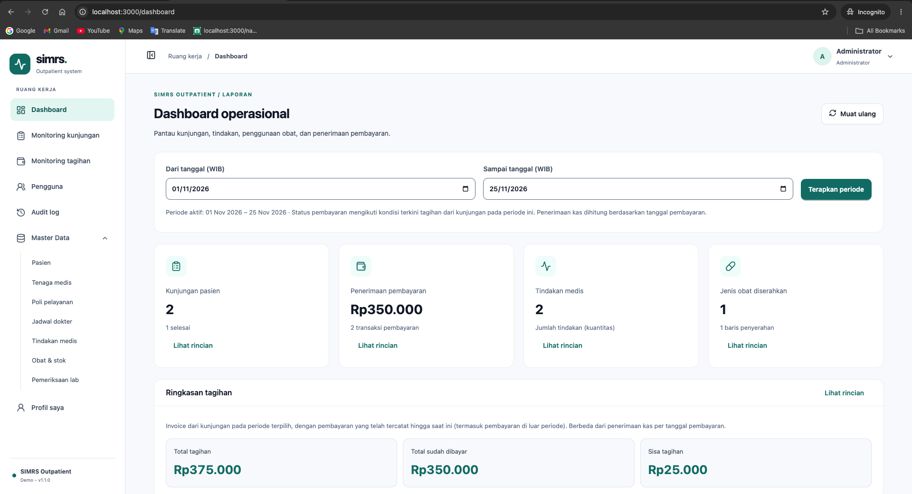
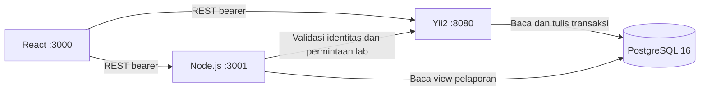

# SIMRS Rawat Jalan Terintegrasi

**Versi 1.1.0 — Hasil verifikasi lokal, 25 November 2026 (WIB)**

Sistem Informasi Manajemen Rumah Sakit (SIMRS) untuk simulasi pelayanan rawat jalan terintegrasi. Aplikasi menghubungkan pengelolaan data master, pendaftaran dan antrean, rekam medis elektronik, tindakan medis, farmasi, laboratorium, penerbitan tagihan, pembayaran, dan pelaporan operasional. Dikembangkan sebagai real case test posisi Senior Programmer PT Inova Medika Solusindo. Seluruh pasien, hasil klinis, dan pembayaran merupakan data dummy. Aplikasi tidak digunakan untuk pelayanan medis nyata.

## Panduan evaluasi hasil pengerjaan

Bagian ini mengikuti lima kategori **F. Output Pengerjaan** pada instruksi Real Case Test Senior Programmer, halaman 5. Seluruh 19 poin memiliki rujukan langsung di repository ini. Status **Tersedia** menunjukkan artefak dapat ditelusuri; status **Lulus** merujuk pada hasil pengujian yang tercatat, bukan penilaian akhir rekruter.

**Akses cepat:** [Kelengkapan source code](#1-source-code) · [Database](#2-database) · [Dokumentasi teknis](#3-dokumentasi-teknis) · [Hasil implementasi](#4-hasil-implementasi) · [Pengujian](#5-pengujian) · [Instalasi lokal](#instalasi-lokal) · [Akun demonstrasi](#akun-demonstrasi) · [Batasan](#pemeliharaan-dan-batasan).

### 1. Source Code

| No. | Permintaan | Lokasi implementasi | Status |
|---|---|---|---|
| 1.1 | Backend utama berbasis Yii | [Backend Yii2](backend-yii/) · [Controller REST](backend-yii/controllers/) · [Layanan bisnis](backend-yii/services/) | Tersedia |
| 1.2 | Frontend React.js | [Frontend React dan TypeScript](frontend/) · [Halaman aplikasi](frontend/src/pages/) | Tersedia |
| 1.3 | Backend services Node.js | [Backend Node.js](backend-node/) · [Integrasi laboratorium](backend-node/src/laboratory.ts) · [Pelaporan](backend-node/src/reporting.ts) | Tersedia |
| 1.4 | Repository Git yang dapat diakses | [Repository GitHub](https://github.com/Al-gast/simrs-outpatient) — branch `main` | Tersedia |

### 2. Database

| No. | Permintaan | Lokasi implementasi | Status |
|---|---|---|---|
| 2.1 | Database schema dan relasi antartabel | [Skema SQL](database/schema.sql) · [Penjelasan relasi](docs/ERD.md) | Tersedia |
| 2.2 | Entity Relationship Diagram (ERD) | [Diagram ERD (SVG)](docs/diagrams/erd.svg) · [Dokumentasi ERD](docs/ERD.md) · [Sumber diagram (DOT)](docs/diagrams/erd.dot) | Tersedia |
| 2.3 | Migration atau SQL instalasi database | [Empat migration Yii](backend-yii/migrations/) · [Inisialisasi hak akses PostgreSQL](database/init/01-roles.sh) · [Panduan instalasi](#instalasi-lokal) | Tersedia |

Empat migration dapat diperiksa langsung:

| Migration | File |
|---|---|
| 000001 — Fondasi skema | [m261124_000001_foundation.php](backend-yii/migrations/m261124_000001_foundation.php) |
| 000002 — Indeks pelaporan | [m261124_000002_reporting_indexes.php](backend-yii/migrations/m261124_000002_reporting_indexes.php) |
| 000003 — Penguatan integritas dan pengujian | [m261124_000003_qa_hardening.php](backend-yii/migrations/m261124_000003_qa_hardening.php) |
| 000004 — Kode otomatis data master | [m261124_000004_master_codes.php](backend-yii/migrations/m261124_000004_master_codes.php) |

Instalasi baru menggunakan migration Yii, bukan menjalankan skema SQL secara terpisah setelah migration. Pengujian upgrade mempertahankan fingerprint 23 tabel bisnis; rollback dan penerapan ulang migration diuji pada database QA terisolasi. Lihat [bukti QA](docs/evidence/automated-qa/runtime-excerpts.txt) dan [panduan upgrade](docs/UPGRADE_V1.1.0.md).

### 3. Dokumentasi Teknis

| No. | Permintaan | Dokumen | Status |
|---|---|---|---|
| 3.1 | Diagram arsitektur aplikasi | [Diagram arsitektur (SVG)](docs/diagrams/architecture.svg) · [Sumber diagram (DOT)](docs/diagrams/architecture.dot) | Tersedia |
| 3.2 | Alur komunikasi React.js, Yii, Node.js dan PostgreSQL | [Arsitektur dan komunikasi layanan](docs/ARCHITECTURE.md) · [Alur transaksi](docs/WORKFLOW.md) | Tersedia |
| 3.3 | Dokumentasi endpoint API | [Referensi REST API](docs/API.md) · [Matriks hak akses](docs/RBAC.md) | Tersedia |
| 3.4 | Petunjuk instalasi dan konfigurasi | [Instalasi lokal](#instalasi-lokal) · [Akun demonstrasi](#akun-demonstrasi) · [Docker Compose](docker-compose.yml) · [Template environment](.env.example) | Tersedia |
| 3.5 | Penjelasan keputusan teknis | [Keputusan teknis dan trade-off](docs/TECHNICAL_DECISIONS.md) · [Pemetaan persyaratan](docs/TRACEABILITY.md) | Tersedia |

Dokumentasi naratif menggunakan Bahasa Indonesia. Identifier, nama endpoint, perintah terminal dan istilah teknis tetap mengikuti implementasi.

### 4. Hasil Implementasi

| No. | Permintaan | Bukti langsung | Status |
|---|---|---|---|
| 4.1 | Screenshot tampilan aplikasi | [34 screenshot aktual](docs/evidence/screenshots/) · [Indeks bukti runtime](docs/evidence/FINAL_RUNTIME_EVIDENCE.md) | Tersedia |
| 4.2 | Alur pelayanan dari pendaftaran hingga pembayaran | [Bukti alur pelayanan](#bukti-alur-pelayanan) · [Panduan demonstrasi](docs/DEMO_WALKTHROUGH.md) | Tersedia |
| 4.3 | Invoice atau struk pembayaran | [Invoice INV-000003](docs/evidence/billing/INV-000003.pdf) · [Kuitansi PAY-000003](docs/evidence/billing/PAY-000003.pdf) · [Kuitansi PAY-000004](docs/evidence/billing/PAY-000004.pdf) | Tersedia |
| 4.4 | Implementasi backend services Node.js | [Integrasi lab](backend-node/src/laboratory.ts) · [Pelaporan](backend-node/src/reporting.ts) · [Bukti eksekusi Node.js](#bukti-integrasi-nodejs) | Tersedia |

#### Bukti alur pelayanan

Tautan berikut membuka setiap screenshot asli dari pengujian browser tanggal 25 November 2026. Bukti disusun mengikuti alur pelayanan, sehingga evaluator tidak perlu mencari file satu per satu.

| Tahapan | Tangkapan layar aktual |
|---|---|
| Dasbor operasional | [Indikator utama](docs/evidence/screenshots/01-dashboard-kpi.png) · [Tren](docs/evidence/screenshots/02-dashboard-trends.png) · [Status pembayaran](docs/evidence/screenshots/03-dashboard-payment-status.png) |
| Data master pasien | [Form pasien](docs/evidence/screenshots/04-master-patient-modal.png) |
| Pendaftaran dan antrean | [Form pendaftaran](docs/evidence/screenshots/05-registration-form.png) · [Pendaftaran berhasil](docs/evidence/screenshots/06-registration-success.png) · [Antrean dokter](docs/evidence/screenshots/07-doctor-queue.png) |
| Rekam medis | [Catatan klinis](docs/evidence/screenshots/08-clinical-record.png) · [Tanda vital](docs/evidence/screenshots/09-clinical-vitals.png) |
| Tindakan medis | [Daftar tindakan](docs/evidence/screenshots/10-procedures.png) · [Total biaya tindakan](docs/evidence/screenshots/11-procedures-total.png) |
| Resep | [Input resep](docs/evidence/screenshots/12-prescription.png) · [Total resep](docs/evidence/screenshots/13-prescription-total.png) |
| Permintaan laboratorium | [Permintaan lab](docs/evidence/screenshots/14-lab-order.png) · [Estimasi biaya](docs/evidence/screenshots/15-lab-estimate.png) |
| Penyelesaian pemeriksaan | [Tinjauan klinis](docs/evidence/screenshots/16-clinical-review.png) · [Data tersimpan](docs/evidence/screenshots/17-review-saved-data.png) · [Total biaya](docs/evidence/screenshots/18-review-total.png) · [Status penunjang](docs/evidence/screenshots/19-ancillary-status.png) |
| Pelayanan laboratorium | [Antrean lab](docs/evidence/screenshots/20-lab-queue.png) · [Hasil pemeriksaan](docs/evidence/screenshots/21-lab-result.png) · [Lab selesai](docs/evidence/screenshots/22-lab-completed.png) |
| Pelayanan farmasi | [Antrean farmasi](docs/evidence/screenshots/23-pharmacy-queue.png) · [Stok sebelum](docs/evidence/screenshots/24-pharmacy-stock-before.png) · [Stok sesudah](docs/evidence/screenshots/25-pharmacy-stock-after.png) · [Penyerahan selesai](docs/evidence/screenshots/26-pharmacy-completed.png) |
| Tagihan | [Daftar tagihan](docs/evidence/screenshots/27-billing-list.png) · [Ruang kerja kasir](docs/evidence/screenshots/28-billing-workspace.png) · [Rincian invoice](docs/evidence/screenshots/29-invoice-items.png) |
| Pembayaran sebagian | [Status tagihan](docs/evidence/screenshots/30-billing-partial-list.png) · [Progres pembayaran](docs/evidence/screenshots/31-payment-progress.png) · [Kuitansi sebagian](docs/evidence/screenshots/32-partial-payment-receipt.png) |
| Pelunasan | [Invoice lunas dan kuitansi](docs/evidence/screenshots/33-paid-invoice-receipts.png) · [Daftar tagihan lunas](docs/evidence/screenshots/34-billing-paid-list.png) |

**Contoh hasil transaksi dummy:** invoice Rp350.000 dilunasi dengan pembayaran tunai Rp150.000 dan pembayaran non-tunai simulasi Rp200.000. Stok obat pada skenario yang sama berkurang dari 90 menjadi 80 unit. File PDF asli dari fitur cetak aplikasi tersedia pada tabel 4.3 di atas.

Bukti screenshot manajemen pengguna dan audit log versi final belum tersedia; fungsi tersebut diuji melalui API dan dikonfirmasi pada UAT. Lihat [UAT final](docs/FINAL_UAT.md) dan [log QA](docs/evidence/automated-qa/runtime-excerpts.txt).

#### Bukti integrasi Node.js

| Skenario | Bukti aktual | Hasil |
|---|---|---|
| Kesehatan layanan Node.js | [Newman request 02](docs/evidence/postman/newman-summary.txt) | HTTP 200 |
| Membaca order lab, mencatat hasil, dan replay event | [Newman request 24–26](docs/evidence/postman/newman-summary.txt) | HTTP 200, assertion lulus |
| Ringkasan pelaporan melalui Node.js | [Newman request 38](docs/evidence/postman/newman-summary.txt) | HTTP 200, assertion lulus |
| Menolak akses laporan oleh kasir | [Newman request 45](docs/evidence/postman/newman-summary.txt) | HTTP 403 sesuai harapan |
| Gangguan dan pemulihan Node.js | [Log QA runtime](docs/evidence/automated-qa/runtime-excerpts.txt) | Lulus |

Node.js berperan sebagai layanan pendukung integrasi laboratorium dan pelaporan; perubahan data bisnis tetap diproses oleh Yii2. Lihat [kontrak API](docs/API.md), [source code Node.js](backend-node/src/) dan [arsitektur](docs/ARCHITECTURE.md).

### 5. Pengujian

| No. | Permintaan | Bukti langsung | Status |
|---|---|---|---|
| 5.1 | Test case fitur utama | [Test case](docs/TEST_CASES.md) · [Panduan pengujian](docs/TESTING.md) · [UAT final](docs/FINAL_UAT.md) | Tersedia |
| 5.2 | Bukti pengujian API menggunakan Postman | [Koleksi End-to-End](postman/End-to-End.postman_collection.json) · [Template environment](postman/SIMRS.postman_environment.json) · [Ringkasan Newman](docs/evidence/postman/newman-summary.txt) · [Laporan JSON](docs/evidence/postman/newman-result.json) | Lulus: 51/51 request, 133/133 assertion |
| 5.3 | Unit test atau integration test transaksi penting | [Pengujian PHP](backend-yii/tests/) · [Pengujian Node.js](backend-node/tests/) · [Pengujian frontend](frontend/tests/) · [Runner QA](scripts/qa-runtime.py) · [Log integrasi aktual](docs/evidence/automated-qa/runtime-excerpts.txt) | Lulus pada skenario yang dijalankan |

Koleksi Postman dijalankan menggunakan Newman CLI pada database QA terisolasi, bukan melalui GUI Postman Desktop. Ringkasan dan laporan JSON berasal dari eksekusi aktual dengan exit code 0. Instruksi rekruter meminta bukti pengujian API menggunakan Postman, tanpa menentukan format screenshot GUI. Lihat [seluruh koleksi Postman](postman/) dan [cara menjalankan ulang](postman/README.md).

Skenario transaksi penting dapat diperiksa melalui script berikut:

| Skenario | Script pengujian |
|---|---|
| Duplikasi pendaftaran, jadwal dan antrean | [visit-smoke.py](scripts/visit-smoke.py) |
| Penyimpanan dan revisi rekam medis | [clinical-smoke.py](scripts/clinical-smoke.py) |
| Stok, resep, idempotency hasil lab dan gangguan layanan | [ancillary-smoke.py](scripts/ancillary-smoke.py) |
| Invoice, pembayaran bertahap dan pencegahan pembayaran ganda | [billing-smoke.py](scripts/billing-smoke.py) |
| Pelaporan dan administrasi | [report-admin-smoke.py](scripts/report-admin-smoke.py) |
| Autentikasi dan kontrol akses | [security-smoke.py](scripts/security-smoke.py) |
| Konsistensi data dan hak akses database | [verify-invariants.sh](scripts/verify-invariants.sh) · [verify-db-grants.sh](scripts/verify-db-grants.sh) |

Hasil lengkap secara ringkas tersedia pada bagian [Demonstrasi dan hasil pengujian](#demonstrasi-dan-hasil-pengujian). Angka pemeriksaan HTTP dan assertion tidak menunjukkan persentase cakupan kode serta bukan bukti kesiapan produksi.

## Fitur utama




| Modul | Kemampuan |
|---|---|
| Data master | Pasien, tenaga medis, poli, jadwal dokter, tindakan, obat dan stok, pemeriksaan laboratorium; kode otomatis dan pengelolaan status. |
| Pendaftaran | Pencarian pasien, jadwal aktif, antrean harian per poli, pencegahan duplikasi. |
| Rekam medis | Ruang kerja dokter dengan lima tahapan, riwayat klinis, validasi, optimistic locking dan alasan perubahan. |
| Tindakan medis | Beberapa tindakan, kuantitas, tarif tersimpan dan revisi biaya sebelum pembayaran. |
| Farmasi | Resep, pemeriksaan stok, penyerahan atomik dan riwayat mutasi. |
| Laboratorium | Permintaan, pencatatan hasil dan integrasi REST melalui Node.js dengan idempotency. |
| Tagihan dan pembayaran | Invoice otomatis, pembayaran bertahap, pencegahan pembayaran ganda, bukti pembayaran individual dan cetak A4. |
| Pelaporan | Grafik kunjungan dan penerimaan, ringkasan tagihan, status pembayaran, rincian berdasarkan periode. |
| Hak akses | Enam peran pengguna, sesi browser, pengelolaan akun, audit aktivitas. |

## Arsitektur dan teknologi



Frontend: React, TypeScript, Vite, Ant Design, TanStack Query, React Router, Axios. Backend utama: PHP 8.3 dan Yii2. Layanan pendukung: Node.js 22, Express, TypeScript, Zod. Basis data: PostgreSQL 16. Infrastruktur lokal: Docker Compose. Yii2 merupakan satu-satunya layanan yang menulis data bisnis; Node.js memvalidasi dan meneruskan hasil lab serta membaca view pelaporan dengan hak akses terbatas. Nilai tarif, stok, status dan otorisasi ditentukan server.

## Instalasi lokal

Siapkan Docker Desktop (Compose v2 atau kompatibel), Git dan Python 3.9+. Koneksi internet dibutuhkan untuk pengunduhan image dan dependency pertama. Pastikan port 3000, 3001 dan 8080 tersedia. Clone repository ini atau ekstrak paket source, lalu masuk ke direktori `simrs-outpatient`.

```bash
bash scripts/setup-env.sh
docker compose config --quiet
docker compose up --build -d
docker compose ps -a
docker compose logs migrate
```

Layanan `migrate` pada instalasi baru harus selesai dengan kode 0 setelah menerapkan empat migration Yii dan mengisi data dummy. Jangan menjalankan `database/schema.sql` secara terpisah setelah migration. Gunakan alamat `localhost` agar origin browser sesuai konfigurasi.

| Layanan | Alamat |
|---|---|
| Aplikasi | http://localhost:3000 |
| Kesehatan Yii2 | http://localhost:8080/api/v1/health |
| Kesehatan Node.js | http://localhost:3001/api/v1/health |
| PostgreSQL | Port 5432 internal Docker, tidak dipublikasikan |

## Akun demonstrasi

Lihat awalan kata sandi yang dihasilkan secara lokal:

```bash
grep '^DEMO_PASSWORD_PREFIX=' .env
```

| Nama pengguna | Pola kata sandi | Halaman awal |
|---|---|---|
| `admin` | `<prefix>-admin` | `/dashboard` |
| `registration` | `<prefix>-registration` | `/registration` |
| `doctor` | `<prefix>-doctor` | `/doctor` |
| `pharmacy` | `<prefix>-pharmacy` | `/pharmacy` |
| `laboratory` | `<prefix>-laboratory` | `/laboratory` |
| `cashier` | `<prefix>-cashier` | `/billing` |

Ganti `<prefix>` dengan nilai lokal tanpa tanda kurung sudut. Jangan membagikan `.env`, awalan kata sandi atau JWT. Seed tidak menimpa akun yang sudah ada. Token berada di memori; cookie HttpOnly memulihkan sesi yang sama selama belum kedaluwarsa. Logout mencabut sesi akun tersebut melalui `token_version`; tidak ada refresh token jangka panjang. Gunakan profil browser berbeda untuk menjalankan beberapa peran secara bersamaan.

## Demonstrasi dan hasil pengujian

Alur utama: pendaftaran → pemeriksaan dokter → laboratorium/farmasi → invoice → pembayaran sebagian → lunas → pelaporan. Lihat [panduan demonstrasi](docs/DEMO_WALKTHROUGH.md).

Pengujian aktual dilakukan pada MacBook Apple Silicon M1, Docker Compose dan PostgreSQL 16 tanggal 25 November 2026. Source aktual mempertahankan perbaikan lokal `Yii\db\JsonExpression` untuk JSONB.

| Pemeriksaan | Hasil |
|---|---|
| Build seluruh layanan Docker dan pengujian paket React/Node.js | Lulus |
| Migration 000004 dan fingerprint 23 tabel bisnis | Lulus; identik sebelum/sesudah |
| UAT terarah | 7/7 kelompok alur utama lulus berdasarkan bukti dan konfirmasi pengguna |
| Pengujian integrasi HTTP terisolasi | 844 pemeriksaan lulus |
| Pengujian kebijakan PHP | 656 assertion lulus |
| Regression statis | 1.554 assertion lulus (termasuk PHP) |
| Postman Collection melalui Newman | 51/51 request, 133/133 assertion; exit code 0 |
| Invariant basis data | 10/10 sebelum dan sesudah gangguan |
| Gangguan Node.js dan pemulihan | Lulus |
| Rollback dan penerapan ulang migration | Lulus pada basis data QA terisolasi |

Bukti: [indeks bukti aktual](docs/evidence/FINAL_RUNTIME_EVIDENCE.md), [tangkapan layar](docs/evidence/screenshots/), [invoice dan kuitansi](docs/evidence/billing/), [log QA terpilih](docs/evidence/automated-qa/runtime-excerpts.txt), [hasil Newman](docs/evidence/postman/newman-summary.txt), [laporan JSON Newman](docs/evidence/postman/newman-result.json), [log statis](docs/evidence/v1.1.0-static-checks.txt). Jumlah assertion bukan persentase cakupan pengujian. Pengujian responsif terperinci, audit dependency, dan pengujian beban produksi belum terbukti lengkap.

## Menjalankan ulang pengujian

Hentikan stack utama tanpa menghapus volume agar port tersedia, lalu jalankan QA pada basis data dummy terisolasi:

```bash
python3 scripts/qa-runtime.py --dry-run --outage
python3 scripts/qa-runtime.py --outage --keep
```

Runner mencetak direktori dan nama proyek QA, serta perintah pembersihan khusus. Hasil mentah berada di `qa-results/` dan harus tetap privat. `--keep` mempertahankan stack untuk Newman/Postman. Tanpa opsi tersebut hanya stack QA yang dibersihkan. Jangan menjalankan smoke test mutasi terhadap data utama. Lihat [panduan pengujian](docs/TESTING.md) dan [panduan Postman/Newman](postman/README.md).

## Struktur repository

| Direktori | Isi |
|---|---|
| `frontend/` | Antarmuka React, komponen bersama, routing dan pengujian helper. |
| `backend-yii/` | REST API utama, layanan domain, kebijakan, migration dan pengujian PHP. |
| `backend-node/` | Integrasi laboratorium, pelaporan, middleware dan pengujian Node.js. |
| `database/` | Schema awal dan inisialisasi hak akses. |
| `scripts/` | Pengujian statis, integrasi, pemeriksaan SQL dan runner QA. |
| `postman/` | Koleksi REST API dan template environment. |
| `docs/` | Dokumentasi teknis dan bukti pengujian. |

## Dokumentasi

- [Persyaratan](docs/REQUIREMENTS.md) dan [pemetaan persyaratan](docs/TRACEABILITY.md)
- [Arsitektur](docs/ARCHITECTURE.md), [ERD](docs/ERD.md), [keputusan teknis](docs/TECHNICAL_DECISIONS.md)
- [Kontrak REST API](docs/API.md), [RBAC](docs/RBAC.md), [alur transaksi](docs/WORKFLOW.md)
- [Spesifikasi UI/UX](docs/UI_UX_SPECIFICATION.md), [skenario pengujian](docs/TEST_CASES.md), [UAT final](docs/FINAL_UAT.md)
- [Catatan rilis v1.1.0](docs/V1.1.0_NOTES.md), [backlog UAT](docs/UAT_BACKLOG.md), [daftar periksa pengumpulan](docs/SUBMISSION_CHECKLIST.md)

## Pemeliharaan dan batasan

Untuk upgrade basis data existing, ikuti [panduan upgrade](docs/UPGRADE_V1.1.0.md); pertahankan `.env`, nama proyek dan volume. Hanya migration 000004 yang baru dibanding v1.0.0. Jangan seed ulang atau menggunakan `docker compose down -v` pada data yang ingin dipertahankan.

```bash
docker compose ps -a
docker compose logs --tail=100 db migrate yii node frontend
docker compose down
```

Pendaftaran hanya hari yang sama (WIB); booking tanggal mendatang dan peringatan di luar jam praktik ditunda. Pembayaran non-tunai merupakan simulasi, bukan payment gateway. Tidak ada rawat inap, BPJS, SATUSEHAT, retur/refund, atau jaminan pengiriman offline yang tahan gangguan. Hasil query menggunakan dataset kecil, bukan SLA produksi. Dependency lockfile belum tersedia pada commit awal; audit dependency dan security audit independen belum dilakukan. Sebelum penerapan nyata diperlukan TLS, pengelolaan rahasia, monitoring, backup/restore teruji, pengujian beban, dan evaluasi keamanan serta kepatuhan. Jangan gunakan data pasien asli.
