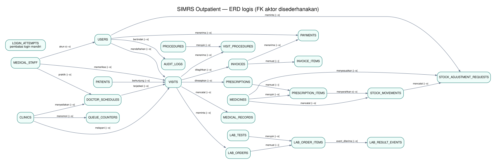
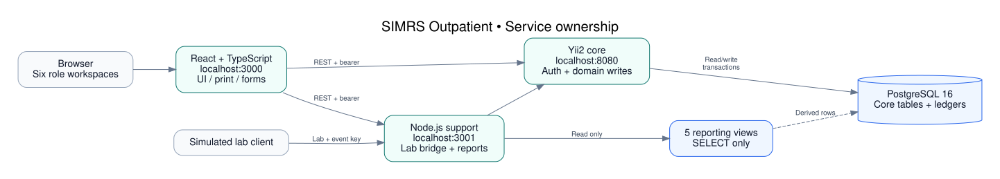
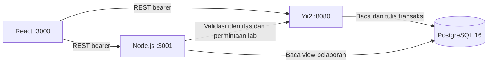

# SIMRS Rawat Jalan Terintegrasi

**Versi 1.1.0 | Terakhir diuji: 25 November 2026 (WIB)**

Aplikasi ini dibuat untuk membantu petugas rumah sakit mengelola pelayanan pasien rawat jalan, mulai dari pasien datang dan mendaftar hingga selesai membayar. Petugas pendaftaran, dokter, petugas laboratorium, farmasi, dan kasir menggunakan sistem yang sama sehingga data pasien dan biaya pelayanan saling terhubung. Admin dapat mengelola data dan melihat laporan kunjungan serta pembayaran.

Aplikasi ini merupakan hasil Real Case Test untuk posisi Senior Programmer di PT Inova Medika Solusindo. Semua data pasien, hasil pemeriksaan, dan pembayaran hanyalah contoh untuk demonstrasi, bukan data pasien sungguhan.

**Alur pelayanan:** Pendaftaran → Antrean dokter → Pemeriksaan → Laboratorium dan/atau farmasi (jika diperlukan) → Tagihan → Pembayaran → Laporan.

Untuk mencoba aplikasi, ikuti [panduan instalasi](#instalasi-lokal). Jika ingin melihat hasilnya tanpa instalasi, buka [tangkapan layar pelayanan](#bukti-alur-pelayanan) dan [contoh invoice serta kuitansi](#4-hasil-implementasi).

## Panduan evaluasi hasil pengerjaan

Berikut hasil pengerjaan berdasarkan 19 poin yang diminta pada bagian F (Output Pengerjaan) dokumen Real Case Test, halaman 5. Klik tautan pada setiap tabel untuk membuka file atau melihat bukti pengujiannya. **Tersedia** berarti file sudah disertakan; **Lulus** berarti pengujian yang dijalankan berhasil.

**Akses cepat:** [Kelengkapan source code](#1-source-code) · [Database](#2-database) · [Dokumentasi teknis](#3-dokumentasi-teknis) · [Hasil implementasi](#4-hasil-implementasi) · [Pengujian](#5-pengujian) · [Instalasi lokal](#instalasi-lokal) · [Akun demonstrasi](#akun-demonstrasi) · [Batasan](#pemeliharaan-dan-batasan).

### 1. Source Code

| No. | Permintaan | File dan folder | Status |
|---|---|---|---|
| 1.1 | Backend utama berbasis Yii | [Backend Yii2](backend-yii/) · [Controller API](backend-yii/controllers/) · [Logika pelayanan](backend-yii/services/) | Tersedia |
| 1.2 | Frontend React.js | [Frontend React dan TypeScript](frontend/) · [Halaman aplikasi](frontend/src/pages/) | Tersedia |
| 1.3 | Backend services Node.js | [Backend Node.js](backend-node/) · [Integrasi laboratorium](backend-node/src/laboratory.ts) · [Pelaporan](backend-node/src/reporting.ts) | Tersedia |
| 1.4 | Repository Git yang dapat diakses | [Repository GitHub](https://github.com/Al-gast/simrs-outpatient) — branch `main` | Tersedia |

### 2. Database

Database menyimpan data yang digunakan bersama oleh petugas. Misalnya, satu pasien dapat memiliki beberapa kunjungan; setiap kunjungan dapat memiliki catatan pemeriksaan, resep, hasil lab, dan tagihan. ERD (Entity Relationship Diagram) menunjukkan hubungan antartabel tersebut.

| No. | Permintaan | File dan folder | Status |
|---|---|---|---|
| 2.1 | Database schema dan relasi antartabel | [Skema SQL](database/schema.sql) · [Penjelasan relasi](docs/ERD.md) | Tersedia |
| 2.2 | Entity Relationship Diagram (ERD) | [Diagram ERD (SVG)](docs/diagrams/erd.svg) · [Dokumentasi ERD](docs/ERD.md) · [Sumber diagram (DOT)](docs/diagrams/erd.dot) | Tersedia |
| 2.3 | Migration atau SQL instalasi database | [Empat migration Yii](backend-yii/migrations/) · [Inisialisasi hak akses PostgreSQL](database/init/01-roles.sh) · [Panduan instalasi](#instalasi-lokal) | Tersedia |



Migration adalah file yang membuat atau memperbarui struktur database secara otomatis. Berikut empat migration yang digunakan:

| Migration | File |
|---|---|
| 000001 — Pembuatan struktur awal database | [m261124_000001_foundation.php](backend-yii/migrations/m261124_000001_foundation.php) |
| 000002 — Indeks pelaporan | [m261124_000002_reporting_indexes.php](backend-yii/migrations/m261124_000002_reporting_indexes.php) |
| 000003 — Penambahan aturan konsistensi data | [m261124_000003_qa_hardening.php](backend-yii/migrations/m261124_000003_qa_hardening.php) |
| 000004 — Kode otomatis data master | [m261124_000004_master_codes.php](backend-yii/migrations/m261124_000004_master_codes.php) |

Saat instalasi pertama, Yii membuat tabel secara otomatis melalui migration. File `schema.sql` disediakan untuk melihat struktur SQL awal; tidak perlu dijalankan lagi setelah migration. Saat aplikasi diperbarui ke v1.1.0, isi 23 tabel bisnis yang diperiksa tidak berubah. Pengujian membatalkan dan menjalankan ulang migration terakhir juga berhasil pada database pengujian terpisah. Lihat [bukti QA](docs/evidence/automated-qa/runtime-excerpts.txt) dan [panduan upgrade](docs/UPGRADE_V1.1.0.md).

### 3. Dokumentasi Teknis

Bagian ini menjelaskan cara aplikasi dibangun, cara layanan saling berkomunikasi, serta alasan di balik pemilihan teknologi dan desain sistem.

| No. | Permintaan | Dokumen | Status |
|---|---|---|---|
| 3.1 | Diagram arsitektur aplikasi | [Diagram arsitektur (SVG)](docs/diagrams/architecture.svg) · [Sumber diagram (DOT)](docs/diagrams/architecture.dot) | Tersedia |
| 3.2 | Alur komunikasi React.js, Yii, Node.js dan PostgreSQL | [Arsitektur dan komunikasi layanan](docs/ARCHITECTURE.md) · [Alur transaksi](docs/WORKFLOW.md) | Tersedia |
| 3.3 | Dokumentasi endpoint API | [Referensi REST API](docs/API.md) · [Matriks hak akses](docs/RBAC.md) | Tersedia |
| 3.4 | Petunjuk instalasi dan konfigurasi | [Instalasi lokal](#instalasi-lokal) · [Akun demonstrasi](#akun-demonstrasi) · [Docker Compose](docker-compose.yml) · [Template environment](.env.example) | Tersedia |
| 3.5 | Penjelasan keputusan teknis | [Alasan pemilihan desain dan teknologi](docs/TECHNICAL_DECISIONS.md) · [Pemetaan persyaratan](docs/TRACEABILITY.md) | Tersedia |


### 4. Hasil Implementasi

| No. | Permintaan | Bukti langsung | Status |
|---|---|---|---|
| 4.1 | Screenshot tampilan aplikasi | [34 tangkapan layar aplikasi](docs/evidence/screenshots/) · [Daftar bukti pengujian](docs/evidence/FINAL_RUNTIME_EVIDENCE.md) | Tersedia |
| 4.2 | Alur pelayanan dari pendaftaran hingga pembayaran | [Bukti alur pelayanan](#bukti-alur-pelayanan) · [Panduan demonstrasi](docs/DEMO_WALKTHROUGH.md) | Tersedia |
| 4.3 | Invoice atau struk pembayaran | [Invoice INV-000003](docs/evidence/billing/INV-000003.pdf) · [Kuitansi PAY-000003](docs/evidence/billing/PAY-000003.pdf) · [Kuitansi PAY-000004](docs/evidence/billing/PAY-000004.pdf) | Tersedia |
| 4.4 | Implementasi backend services Node.js | [Integrasi lab](backend-node/src/laboratory.ts) · [Pelaporan](backend-node/src/reporting.ts) · [Bukti eksekusi Node.js](#bukti-integrasi-nodejs) | Tersedia |

#### Bukti alur pelayanan

Tangkapan layar berikut diambil saat aplikasi dicoba pada 25 November 2026. Mulai dari pendaftaran hingga pelunasan, setiap tahap dapat dilihat melalui tautan di bawah ini.

| Tahapan | Tangkapan layar aktual |
|---|---|
| Dasbor operasional | [Indikator utama](docs/evidence/screenshots/01-dashboard-kpi.png) · [Tren](docs/evidence/screenshots/02-dashboard-trends.png) · [Status pembayaran](docs/evidence/screenshots/03-dashboard-payment-status.png) |
| Data master pasien | [Form pasien](docs/evidence/screenshots/04-master-patient-modal.png) |
| Pendaftaran dan antrean | [Form pendaftaran](docs/evidence/screenshots/05-registration-form.png) · [Pendaftaran berhasil](docs/evidence/screenshots/06-registration-success.png) · [Antrean dokter](docs/evidence/screenshots/07-doctor-queue.png) |
| Rekam medis | [Catatan klinis](docs/evidence/screenshots/08-clinical-record.png) · [Tanda vital](docs/evidence/screenshots/09-clinical-vitals.png) |
| Tindakan medis | [Daftar tindakan](docs/evidence/screenshots/10-procedures.png) · [Total biaya tindakan](docs/evidence/screenshots/11-procedures-total.png) |
| Resep | [Input resep](docs/evidence/screenshots/12-prescription.png) · [Total resep](docs/evidence/screenshots/13-prescription-total.png) |
| Permintaan laboratorium | [Permintaan lab](docs/evidence/screenshots/14-lab-order.png) · [Estimasi biaya](docs/evidence/screenshots/15-lab-estimate.png) |
| Penyelesaian pemeriksaan | [Ringkasan pemeriksaan](docs/evidence/screenshots/16-clinical-review.png) · [Data tersimpan](docs/evidence/screenshots/17-review-saved-data.png) · [Total biaya](docs/evidence/screenshots/18-review-total.png) · [Status lab dan farmasi](docs/evidence/screenshots/19-ancillary-status.png) |
| Pelayanan laboratorium | [Antrean lab](docs/evidence/screenshots/20-lab-queue.png) · [Hasil pemeriksaan](docs/evidence/screenshots/21-lab-result.png) · [Lab selesai](docs/evidence/screenshots/22-lab-completed.png) |
| Pelayanan farmasi | [Antrean farmasi](docs/evidence/screenshots/23-pharmacy-queue.png) · [Stok sebelum](docs/evidence/screenshots/24-pharmacy-stock-before.png) · [Stok sesudah](docs/evidence/screenshots/25-pharmacy-stock-after.png) · [Penyerahan selesai](docs/evidence/screenshots/26-pharmacy-completed.png) |
| Tagihan | [Daftar tagihan](docs/evidence/screenshots/27-billing-list.png) · [Halaman kasir](docs/evidence/screenshots/28-billing-workspace.png) · [Rincian invoice](docs/evidence/screenshots/29-invoice-items.png) |
| Pembayaran sebagian | [Status tagihan](docs/evidence/screenshots/30-billing-partial-list.png) · [Jumlah pembayaran dan sisa tagihan](docs/evidence/screenshots/31-payment-progress.png) · [Kuitansi sebagian](docs/evidence/screenshots/32-partial-payment-receipt.png) |
| Pelunasan | [Invoice lunas dan kuitansi](docs/evidence/screenshots/33-paid-invoice-receipts.png) · [Daftar tagihan lunas](docs/evidence/screenshots/34-billing-paid-list.png) |

**Contoh pelayanan pasien:** total tagihan Rp350.000 dibayar dua kali, yaitu Rp150.000 secara tunai dan Rp200.000 melalui simulasi pembayaran non-tunai. Setelah pembayaran kedua, tagihan berstatus lunas. Pada kunjungan yang sama, petugas farmasi menyerahkan 10 unit obat sehingga stok berkurang dari 90 menjadi 80 unit. Contoh invoice dan kedua kuitansi dapat dibuka melalui tabel 4.3 di atas.

Tangkapan layar pengelolaan akun dan riwayat aktivitas pengguna untuk versi terakhir belum disertakan. Kedua fitur sudah diperiksa saat uji coba aplikasi dan melalui API. Lihat [UAT final](docs/FINAL_UAT.md) dan [log QA](docs/evidence/automated-qa/runtime-excerpts.txt).

#### Bukti integrasi Node.js

| Skenario | Bukti aktual | Hasil |
|---|---|---|
| Memastikan layanan Node.js berjalan | [Newman request 02](docs/evidence/postman/newman-summary.txt) | HTTP 200 |
| Membaca permintaan lab, menyimpan hasil, dan mengirim ulang permintaan yang sama | [Newman request 24–26](docs/evidence/postman/newman-summary.txt) | HTTP 200; pemeriksaan lulus |
| Ringkasan pelaporan melalui Node.js | [Newman request 38](docs/evidence/postman/newman-summary.txt) | HTTP 200; pemeriksaan lulus |
| Menolak akses laporan oleh kasir | [Newman request 45](docs/evidence/postman/newman-summary.txt) | HTTP 403 sesuai harapan |
| Gangguan dan pemulihan Node.js | [Log QA runtime](docs/evidence/automated-qa/runtime-excerpts.txt) | Lulus |

Node.js digunakan untuk menerima hasil pemeriksaan laboratorium dan menyediakan data laporan. Yii2 tetap bertanggung jawab menyimpan perubahan data ke database. Pengiriman ulang hasil lab yang sama diuji untuk memastikan tidak menghasilkan pencatatan ganda. Lihat [kontrak API](docs/API.md), [source code Node.js](backend-node/src/) dan [arsitektur](docs/ARCHITECTURE.md).

### 5. Pengujian

| No. | Permintaan | Bukti langsung | Status |
|---|---|---|---|
| 5.1 | Test case fitur utama | [Test case](docs/TEST_CASES.md) · [Panduan pengujian](docs/TESTING.md) · [UAT final](docs/FINAL_UAT.md) | Tersedia |
| 5.2 | Bukti pengujian API menggunakan Postman | [Koleksi End-to-End](postman/End-to-End.postman_collection.json) · [Template environment](postman/SIMRS.postman_environment.json) · [Ringkasan Newman](docs/evidence/postman/newman-summary.txt) · [Laporan JSON](docs/evidence/postman/newman-result.json) | Lulus: 51 dari 51 request, 133 dari 133 pemeriksaan |
| 5.3 | Unit test atau integration test transaksi penting | [Pengujian PHP](backend-yii/tests/) · [Pengujian Node.js](backend-node/tests/) · [Pengujian frontend](frontend/tests/) · [Runner QA](scripts/qa-runtime.py) · [Log integrasi aktual](docs/evidence/automated-qa/runtime-excerpts.txt) | Lulus pada pengujian yang dilakukan |

Pengujian API dilakukan menggunakan Newman, alat untuk menjalankan koleksi Postman melalui terminal tanpa membuka aplikasi Postman Desktop. Semua 51 permintaan API dan 133 pemeriksaan hasilnya berhasil pada database pengujian terpisah (exit code 0). Laporan hasil pengujian tersedia dalam format teks dan JSON. Lihat [seluruh koleksi Postman](postman/) dan [cara menjalankan ulang](postman/README.md).

Berikut file pengujian untuk beberapa proses penting, termasuk pencegahan pendaftaran, pencatatan hasil lab, dan pembayaran ganda:

| Skenario | Script pengujian |
|---|---|
| Duplikasi pendaftaran, jadwal dan antrean | [visit-smoke.py](scripts/visit-smoke.py) |
| Penyimpanan dan revisi rekam medis | [clinical-smoke.py](scripts/clinical-smoke.py) |
| Stok obat, resep, pengiriman ulang hasil lab dan gangguan layanan | [ancillary-smoke.py](scripts/ancillary-smoke.py) |
| Invoice, pembayaran bertahap dan pencegahan pembayaran ganda | [billing-smoke.py](scripts/billing-smoke.py) |
| Pelaporan dan administrasi | [report-admin-smoke.py](scripts/report-admin-smoke.py) |
| Autentikasi dan kontrol akses | [security-smoke.py](scripts/security-smoke.py) |
| Konsistensi data dan hak akses database | [verify-invariants.sh](scripts/verify-invariants.sh) · [verify-db-grants.sh](scripts/verify-db-grants.sh) |

Ringkasan hasil dapat dilihat pada bagian [Demonstrasi dan hasil pengujian](#demonstrasi-dan-hasil-pengujian). Jumlah pengujian yang lulus tidak berarti seluruh kemungkinan kesalahan telah diuji atau aplikasi siap digunakan di rumah sakit.

## Fitur utama


| Modul | Kemampuan |
|---|---|
| Data master | Mengelola pasien, tenaga medis, poli, jadwal dokter, tindakan, obat, stok, dan jenis pemeriksaan lab. Kode data dibuat otomatis. |
| Pendaftaran | Mencari pasien, memilih jadwal dokter, membuat nomor antrean per poli, dan mencegah pendaftaran ganda. |
| Rekam medis | Dokter mencatat keluhan, hasil pemeriksaan, tindakan, resep dan permintaan lab dalam lima tahapan. Perubahan data memerlukan alasan sesuai aturan; perubahan bersamaan diperiksa agar data tidak saling tertimpa (optimistic locking). |
| Tindakan medis | Mencatat beberapa tindakan beserta jumlah dan tarifnya. Biaya dapat diperbarui sebelum pembayaran sesuai aturan sistem. |
| Farmasi | Menerima resep, memeriksa ketersediaan obat, menyerahkan obat, dan mencatat perubahan stok. Penyerahan dan pengurangan stok disimpan dalam satu transaksi. |
| Laboratorium | Menerima permintaan pemeriksaan, menyimpan hasil, dan mencegah pencatatan ganda saat permintaan yang sama dikirim ulang melalui Node.js (idempotency). |
| Tagihan dan pembayaran | Membuat tagihan otomatis, menerima pembayaran sebagian atau pelunasan, mencegah pembayaran ganda, dan mencetak invoice serta kuitansi ukuran A4. |
| Pelaporan | Melihat grafik jumlah kunjungan, penerimaan pembayaran, tagihan yang belum lunas, dan rincian laporan berdasarkan periode. |
| Hak akses | Membatasi menu dan tindakan berdasarkan enam jenis pengguna, mengelola akun, dan mencatat riwayat aktivitas. |

## Arsitektur dan teknologi





Aplikasi dibagi menjadi beberapa bagian agar tampilan, aturan pelayanan, dan penyimpanan data memiliki tanggung jawab yang jelas.

| Bagian | Fungsi | Teknologi |
|---|---|---|
| Frontend | Tampilan dan formulir yang digunakan petugas | React, TypeScript, Vite, Ant Design, TanStack Query, React Router, Axios |
| Backend utama | Memeriksa hak akses, menghitung biaya, mengatur stok dan menyimpan transaksi | PHP 8.3, Yii2 |
| Backend pendukung | Menerima hasil laboratorium dan menyediakan laporan | Node.js 22, Express, TypeScript, Zod |
| Database | Menyimpan data pasien, kunjungan, obat, tagihan dan pembayaran | PostgreSQL 16 |
| Lingkungan lokal | Menjalankan seluruh layanan dalam satu konfigurasi | Docker Compose |

Yii2 menjadi satu-satunya layanan yang menulis data bisnis. Node.js meneruskan hasil lab ke Yii2 dan hanya membaca view database yang diizinkan untuk pelaporan. Tarif, stok, status pelayanan, dan izin pengguna ditentukan oleh server, bukan oleh browser. Lihat [penjelasan arsitektur](docs/ARCHITECTURE.md) untuk detail teknis.

## Instalasi lokal

Untuk mencoba aplikasi di komputer sendiri, siapkan Docker Desktop (Compose v2 atau yang kompatibel), Git, dan Python 3.9 atau lebih baru. Koneksi internet diperlukan saat instalasi pertama untuk mengunduh komponen aplikasi. Pastikan port 3000, 3001, dan 8080 tidak dipakai aplikasi lain.

Unduh repository ini melalui Git atau ekstrak paket source code, masuk ke folder `simrs-outpatient`, lalu jalankan perintah berikut:

```bash
bash scripts/setup-env.sh
docker compose config --quiet
docker compose up --build -d
docker compose ps -a
docker compose logs migrate
```

Pada instalasi pertama, layanan `migrate` membuat struktur database dan mengisi data contoh. Status selesai dengan kode 0 berarti proses tersebut berhasil. Tidak perlu menjalankan `database/schema.sql` lagi. Setelah layanan berjalan, buka aplikasi di **http://localhost:3000**. Gunakan `localhost` agar alamat browser sesuai konfigurasi.

| Layanan | Alamat |
|---|---|
| Aplikasi | http://localhost:3000 |
| Pemeriksaan status Yii2 | http://localhost:8080/api/v1/health |
| Pemeriksaan status Node.js | http://localhost:3001/api/v1/health |
| PostgreSQL | Port 5432 internal Docker, tidak dipublikasikan |

## Akun demonstrasi

Terdapat enam akun contoh sesuai tugas masing-masing petugas. Untuk mengetahui awalan kata sandi yang dibuat saat instalasi, jalankan perintah berikut di terminal:

```bash
grep '^DEMO_PASSWORD_PREFIX=' .env
```

| Nama pengguna | Pola kata sandi | Halaman awal |
|---|---|---|
| `admin` | `<prefix>-admin` | `/dashboard` |
| `registration` | `<prefix>-registration` | `/registration` |
| `doctor` | `<prefix>-doctor` | `/doctor` |
| `pharmacy` | `<prefix>-pharmacy` | `/pharmacy` |
| `laboratory` | `<prefix>-laboratory` | `/laboratory` |
| `cashier` | `<prefix>-cashier` | `/billing` |

Ganti `<prefix>` dengan awalan kata sandi yang muncul pada terminal, tanpa tanda kurung sudut. Jangan membagikan `.env`, awalan kata sandi, atau token login (JWT). Pengisian data contoh tidak menimpa akun yang sudah ada.

Jika ingin mencoba beberapa peran sekaligus, gunakan profil browser yang berbeda. Sesi login dapat dipulihkan selama belum kedaluwarsa melalui cookie HttpOnly; token disimpan di memori. Saat logout, sesi akun dicabut melalui `token_version`. Sistem tidak memakai refresh token jangka panjang.

## Demonstrasi dan hasil pengujian

Alur utama: pendaftaran → pemeriksaan dokter → laboratorium/farmasi → invoice → pembayaran sebagian → lunas → pelaporan. Lihat [panduan demonstrasi](docs/DEMO_WALKTHROUGH.md).

Pengujian dilakukan pada 25 November 2026 menggunakan MacBook Apple Silicon M1, Docker Compose, dan PostgreSQL 16. Versi source code yang diuji menggunakan `Yii\db\JsonExpression` untuk menyimpan data JSONB di PostgreSQL.

| Pemeriksaan | Hasil |
|---|---|
| Pembuatan image Docker dan pengujian React/Node.js | Lulus |
| Migration 000004 dan pemeriksaan isi 23 tabel bisnis | Lulus; isi tabel tidak berubah sebelum dan sesudah upgrade |
| Uji coba alur aplikasi secara langsung (UAT) | 7 dari 7 kelompok alur utama lulus berdasarkan tangkapan layar dan konfirmasi uji coba |
| Pengujian integrasi API pada database terpisah | 844 pemeriksaan lulus |
| Pengujian aturan bisnis dan keamanan PHP | 656 assertion lulus |
| Pengujian ulang aturan dan kode secara statis | 1.554 assertion lulus (termasuk PHP) |
| Postman Collection melalui Newman | 51/51 request, 133/133 assertion; exit code 0 |
| Pemeriksaan konsistensi database | 10/10 sebelum dan sesudah gangguan |
| Gangguan Node.js dan pemulihan | Lulus |
| Rollback dan penerapan ulang migration | Lulus pada basis data QA terisolasi |

Bukti: [daftar bukti pengujian](docs/evidence/FINAL_RUNTIME_EVIDENCE.md), [tangkapan layar](docs/evidence/screenshots/), [invoice dan kuitansi](docs/evidence/billing/), [log QA terpilih](docs/evidence/automated-qa/runtime-excerpts.txt), [hasil Newman](docs/evidence/postman/newman-summary.txt), [laporan JSON Newman](docs/evidence/postman/newman-result.json), [log statis](docs/evidence/v1.1.0-static-checks.txt). Jumlah assertion adalah jumlah pemeriksaan hasil yang dilakukan, bukan persentase kode yang sudah diuji. Pengujian tampilan di berbagai ukuran layar, pemeriksaan keamanan dependency, dan pengujian beban produksi belum dilakukan secara menyeluruh.

## Menjalankan ulang pengujian

Jika ingin mengulang pengujian, hentikan layanan aplikasi utama tanpa menghapus volume database agar port dapat digunakan oleh layanan pengujian. Jalankan perintah berikut untuk membuat database contoh yang terpisah dari database utama:

```bash
python3 scripts/qa-runtime.py --dry-run --outage
python3 scripts/qa-runtime.py --outage --keep
```

Script pengujian akan menampilkan nama proyek, folder pengujian, dan perintah untuk menghentikannya. Hasil mentah berada di `qa-results/` dan tidak boleh dipublikasikan karena dapat berisi informasi sensitif. Opsi `--keep` membiarkan layanan pengujian tetap berjalan untuk Newman/Postman. Tanpa opsi tersebut, hanya layanan QA yang dibersihkan. Jangan jalankan pengujian yang mengubah data pada database utama. Lihat [panduan pengujian](docs/TESTING.md) dan [panduan Postman/Newman](postman/README.md).

## Struktur repository

| Direktori | Isi |
|---|---|
| `frontend/` | Tampilan aplikasi React, komponen, navigasi halaman dan pengujian. |
| `backend-yii/` | API utama, aturan pelayanan, migration dan pengujian PHP. |
| `backend-node/` | Integrasi laboratorium, pelaporan, pemeriksaan akses dan pengujian Node.js. |
| `database/` | Struktur awal database dan pengaturan hak akses. |
| `scripts/` | Script pengujian kode, API dan database. |
| `postman/` | Koleksi REST API dan template environment. |
| `docs/` | Dokumentasi teknis dan bukti pengujian. |

## Dokumentasi

- [Persyaratan](docs/REQUIREMENTS.md) dan [pemetaan persyaratan](docs/TRACEABILITY.md)
- [Arsitektur](docs/ARCHITECTURE.md), [ERD](docs/ERD.md), [keputusan teknis](docs/TECHNICAL_DECISIONS.md)
- [Kontrak REST API](docs/API.md), [RBAC](docs/RBAC.md), [alur transaksi](docs/WORKFLOW.md)
- [Spesifikasi UI/UX](docs/UI_UX_SPECIFICATION.md), [skenario pengujian](docs/TEST_CASES.md), [UAT final](docs/FINAL_UAT.md)
- [Catatan rilis v1.1.0](docs/V1.1.0_NOTES.md), [backlog UAT](docs/UAT_BACKLOG.md), [daftar periksa pengumpulan](docs/SUBMISSION_CHECKLIST.md)

## Pemeliharaan dan batasan

Jika sudah memiliki database dari versi sebelumnya, ikuti [panduan upgrade](docs/UPGRADE_V1.1.0.md). Pertahankan `.env`, nama proyek, dan volume database agar data lama tetap tersedia. Dibandingkan v1.0.0, versi ini hanya menambahkan migration 000004. Jangan mengisi ulang data contoh atau menjalankan `docker compose down -v` pada database yang ingin dipertahankan.

Perintah berikut digunakan untuk melihat status layanan, membaca log, atau menghentikan aplikasi tanpa menghapus volume database:

```bash
docker compose ps -a
docker compose logs --tail=100 db migrate yii node frontend
docker compose down
```

### Batasan aplikasi saat ini

- Pendaftaran hanya untuk kunjungan pada hari yang sama (WIB). Pemesanan untuk tanggal mendatang dan peringatan di luar jam praktik belum tersedia.
- Pembayaran non-tunai hanya simulasi, belum terhubung dengan payment gateway.
- Rawat inap, BPJS, SATUSEHAT, pengembalian pembayaran (refund), dan jaminan pengiriman hasil lab saat layanan offline belum tersedia.
- Pemeriksaan kecepatan database dilakukan dengan data contoh berukuran kecil, bukan pengujian beban rumah sakit.
- File pengunci versi dependency belum tersedia pada commit awal. Audit dependency dan audit keamanan independen belum dilakukan.

Aplikasi ini dibuat sebagai demonstrasi technical test, belum untuk pelayanan medis nyata. Sebelum digunakan di rumah sakit, diperlukan HTTPS/TLS, pengamanan kredensial, pemantauan sistem, pengujian pemulihan cadangan database, pengujian beban, serta pemeriksaan keamanan dan kepatuhan. Jangan gunakan data pasien asli.
