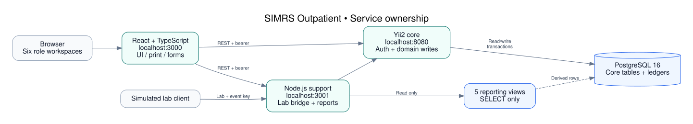
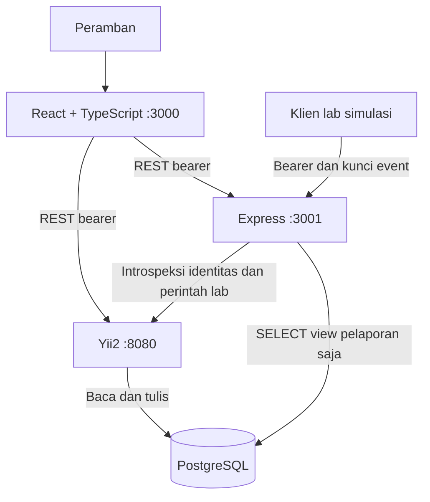

# Arsitektur dan batas tanggung jawab layanan

## Pembagian tanggung jawab

- React menangani menu sesuai peran, formulir, cache query, navigasi, dan pencetakan. Tidak menentukan otorisasi, tarif, status atau stok final.
- Yii2: controller memvalidasi permintaan dan autentikasi; service menjalankan otorisasi, transisi status, penguncian dan transaksi. Query Builder/SQL berparameter. Seluruh perubahan data bisnis termasuk hasil lab, invoice dan migration dimiliki Yii2.
- Node.js: middleware memvalidasi bearer melalui `/api/v1/auth/me` milik Yii2 pada setiap request terlindungi; Zod memvalidasi input, izin dan DTO. Meneruskan bearer, Request ID dan event key asli untuk lab. Tidak menggunakan identitas layanan istimewa untuk melewati izin pengguna. Pelaporan menggunakan SQL berparameter pada view yang diizinkan.
- PostgreSQL: sumber kebenaran transaksi. `simrs_owner` untuk migration, `simrs_core` untuk transaksi, `simrs_report` hanya CONNECT, USAGE schema reporting dan SELECT pada lima view. Tidak boleh membaca tabel inti langsung atau menulis data.

## Lingkungan dan autentikasi

PHP 8.3/Yii2/Composer/PDO PostgreSQL; Node 22/Express/Zod/TypeScript; React/Vite/Ant Design/TanStack Query/React Router/Axios; PostgreSQL 16. Compose mengatur `db`, `migrate` satu kali, `yii`, `node`, `frontend`. Port publik demo hanya loopback. Health endpoint digunakan untuk memeriksa kesiapan. PHP CLI server dengan empat worker untuk demonstrasi concurrency, Nginx melayani SPA; bukan deployment produksi. Rahasia berasal dari `.env`, template hanya placeholder. Dependency lockfile perlu dibuat dari resolusi aktual; jangan mengarangnya.

Yii menerbitkan JWT HS256 dengan `sub`, `iat`, `exp`, `iss`, `aud`, `jti`, `token_version`; memvalidasi algoritma, expiry, issuer, audience, akun aktif dan versi token. Rahasia signing acak minimal 32 byte hanya untuk Core. Password di-hash bcrypt; pesan gagal generik dan pembatasan login. Tidak ada pendaftaran publik. Logout dan perubahan akun mencabut sesi melalui versi token.

Bearer berada di memori browser. Cookie host-only HttpOnly SameSite=Strict hanya pada `/api/v1/auth/browser/`, maksimum 7200 detik. POST login/restore/logout khusus browser memerlukan Origin tepat dan JSON. Restore tidak memperpanjang expiry. HTTPS dan Secure wajib di luar demo localhost. Cookie saja tidak mengotorisasi API bisnis atau Node. CORS dibatasi origin frontend. Marker generasi sesi antar-tab tidak berisi kredensial; logout bearer lama tidak mencabut cookie akun lain, restore 401 tidak menghapus cookie baru. Koordinasi best effort; profil browser terpisah untuk sesi berbeda. Node gagal tertutup dengan 503 jika Core tidak tersedia. Request ID untuk korelasi, tanpa PHI atau rahasia dalam log aplikasi.

## Keputusan arsitektur

| Keputusan | Alasan dan konsekuensi |
|---|---|
| Satu repository, tiga layanan aplikasi | Evaluasi mudah; tidak memerlukan pipeline independen. |
| Yii sebagai penulis tunggal | Aturan transaksi tidak diduplikasi; Node bergantung pada Core untuk autentikasi. |
| Lock dan constraint PostgreSQL | Tidak membutuhkan Redis atau distributed lock; urutan lock harus konsisten. |
| Bigint Rupiah dan snapshot harga | Presisi eksak; serialisasi string desimal, batas nilai dan kuantitas. |
| Status eksplisit dan revisi invoice | Biaya terkunci setelah pembayaran pertama; belum ada refund. |
| WIB dan `timestamptz` | Tanggal kunjungan lokal, filter pembayaran memakai rentang timestamp setengah terbuka. |
| Integrasi lab sinkron | Pengirim harus menyimpan event belum terkonfirmasi; tidak ada antrean durable di Node. |
| Deaktivasi data berreferensi | Riwayat tetap ada; penghapusan fisik hanya jika aman. |
| Satu peran per akun | Izin sederhana, pembatasan dokter secara eksplisit. |
| Cetak browser | Memenuhi invoice/kuitansi tanpa gateway pembayaran nyata. |

## Integrasi dan pelaporan

Node melakukan introspeksi dengan timeout 3 detik dan proxy lab 4 detik; UI hasil lab memberi waktu 10 detik. Timeout atau error jaringan menghasilkan 503 `UPSTREAM_UNAVAILABLE` dengan hasil transaksi belum pasti. Pengirim mempertahankan payload/key dan mengulang dengan key sama. Replay event diterima mengembalikan kondisi order saat ini; payload berbeda ditolak 409. Petugas dapat memakai fallback Core secara eksplisit. Tidak ada jaminan exactly-once delivery, durable inbox atau jaminan tanpa kehilangan jika pengirim tidak menyimpan event. Dashboard menampilkan kegagalan, bukan angka nol palsu.

Pelaporan memakai transaksi read-only `REPEATABLE READ`, lima view dan parameter tetap. Summary konsisten dalam satu snapshot; detail terpisah dapat berubah jika ada transaksi baru. Penerimaan kas menggunakan `paid_at`; total tagihan/sudah dibayar/sisa menggunakan kelompok invoice berdasarkan tanggal kunjungan dan kondisi terkini. BigInt di frontend menjaga presisi. Tidak ada nama pasien atau isi klinis dalam DTO pelaporan.

## Perubahan versi final

Ruang kerja dokter `/doctor/:visitId`, kasir `/billing/:visitId`, admin `/billing-monitor/:visitId` memakai React Router Data Router dan `useBlocker`. Lima langkah UI bukan status baru di database. Format nomor RX/LAB/INV/PAY hanya presentasi. Nama tenaga medis ditambah lewat left join pada daftar akun; audit tetap metadata. UI menggunakan SVG/CSS tanpa dependency grafik baru. Migration terakhir menambah lima sequence kode master; struktur lainnya dipertahankan. Pengujian lokal final tercatat di [bukti aktual](evidence/FINAL_RUNTIME_EVIDENCE.md). Desain ini bukan jaminan kesiapan produksi.
