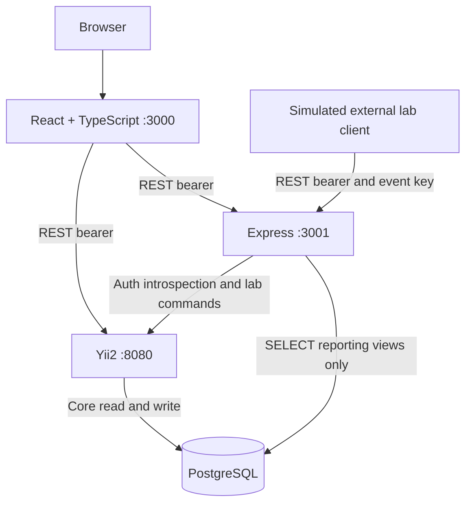

# Architecture & technical decisions

## Responsibility boundary

- React: role-based menus, forms, query cache, print invoice/receipt; never authoritative for prices, status, stock or permissions.
- Yii: controllers parse request and authenticate; services enforce authorization, state transitions, locks and transactions; Yii Query and parameterized SQL persist; Yii owns every write including lab results and reporting schema migrations.
- Node: authenticate bearer using Yii `/api/v1/auth/me`, enforce dashboard/lab permission, validate inputs with Zod, forward lab commands with original bearer and event key; use parameterized read-only reporting SQL. Never trust a role header. Do not use a privileged service identity to bypass end-user authorization.
- PostgreSQL: single transactional source of truth. Separate core runtime, migration and reporting roles where feasible. Node receives only CONNECT, USAGE on reporting schema, SELECT on named reporting views; no table writes or direct core reads. The migration role owns views. Verify grants on fresh DB.

## Stack / runtime targets

React + TypeScript + Vite + Ant Design + TanStack Query + React Router + Axios; PHP 8.3/Yii2 with Composer and PDO PostgreSQL; Node 22/Express/TypeScript/Zod; PostgreSQL 16. These are compatibility targets, not verified latest releases or built images. Lockfiles must be generated after successful package resolution. Docker Compose (frontend :3000, Yii :8080, Node :3001, PostgreSQL internal :5432). Bind demo ports to loopback by default. Database readiness precedes migration/seed; Core and Node readiness endpoints gate dependent services. All secrets from env; `.env.example` uses placeholders. Production requires TLS, stronger operational controls and secret rotation.

## Frontend visual direction

Approved design: Premium Healthcare SaaS, white sidebar, teal accent and spacious layout. Use Ant Design theme overrides and shared components defined in [UI/UX specification](UI_UX_SPECIFICATION.md) and [design tokens](UI_TOKENS.json). UI changes do not change service ownership or RBAC.

## Authentication

Yii issues short-lived HS256 JWT (e.g. 2h demo) with `sub`, `iat`, `exp`, `iss`, `aud`, `jti`, `token_version`. Pin algorithm, validate expiry/issuer/audience, load active user and compare token_version on each request. Yii alone holds signing secret (random >=32 bytes). Passwords hashed with PHP password_hash/verify or Yii Security; login errors generic, throttle failed attempts. No public registration. Logout increments token_version (revokes all user sessions, MVP trade-off). Password or role changes and deactivation also revoke sessions. React stores the bearer in memory. v1.0.1 adds a host-only HttpOnly SameSite=Strict cookie restricted to `/api/v1/auth/browser/`; browser-only POST login/restore/logout require the exact configured Origin and JSON. Restore validates the original token and account version, without extending its expiry. Business endpoints and Node remain bearer-only. No localStorage for patient data or tokens; a non-secret logout suppression flag may be stored. HTTPS + Secure is required outside the localhost demo. Node validates identity via Yii `/auth/me` on every protected request, no cached identity in MVP; core outage -> fail closed 503. CORS restricted to configured frontend origin; bearer not automatically sent by browser cross-site. Request IDs propagated; no PHI or credentials in application logs.

## Decision records

| ADR | Decision | Trade-off |
|---|---|---|
| 01 | Single repository with three services | Easy evaluation; no independent release pipeline needed. |
| 02 | Yii sole writer, Node read-only and forwarding | Prevents duplicate domain logic; dashboard and integrations depend on core for auth. |
| 03 | PostgreSQL row locks, constraints, transactions | No distributed lock or Redis needed; lock order and short transactions matter. |
| 04 | Integer rupiah (bigint), server snapshots | No floating-point rounding; validate bounded amounts, serialize as decimal strings. |
| 05 | Explicit workflow, invoice revision and first-payment freeze | Avoids retroactive changes; no post-payment adjustment/refund workflow in MVP. |
| 06 | Local date Asia/Jakarta, instants timestamptz | Reports use half-open timestamp ranges; calendar visits stored as date. |
| 07 | Synchronous lab bridge with sender-owned retries | Core continues if Node is down; external caller must retain unacknowledged events. No claim of durable Node queue or exactly-once delivery. |
| 08 | Deactivation of referenced master records | History retained; literal DELETE allowed only if safe, FK remains protective. |
| 09 | Single-role accounts and explicit doctor scope | Simpler permissions; no multi-role or clinical-team access models. |
| 10 | Browser print, no external gateway | Meets print and simulated payment requirements; real medical deployment excluded. |

## Integration failure behavior

Node forwards lab writes with a stable event key and timeout (e.g. 3s). On upstream timeout or network error return 503 `UPSTREAM_UNAVAILABLE`; commit status may be unknown. Do not report success until Yii confirms. Caller keeps original payload and key in its durable sender system, retries the same request (Postman simulation demonstrates this). A duplicate accepted event returns its original result identity; different payload/actor/item with same key returns 409. Core lab staff can save through Yii even if Node is down. Dashboard displays unavailable, not fake zero. No automatic retries for unkeyed writes; read-only operations can be retried with bounded backoff. If external sender cannot persist events, no loss-free guarantee is possible; an inbox/outbox would be a future improvement.

## Phase 2 implementation delta

Compose now has `db`, one-shot `migrate`, `yii`, `node`, `frontend`. Migration/seed uses `simrs_owner`; core runtime `simrs_core`; report service `simrs_report`. The migration imports the original 22-table baseline plus `login_attempts` (23 application tables, and Yii's own `migration` metadata table). Core auth uses `firebase/php-jwt`; Node never receives the signing secret. Browser bearer is memory-only. Phase 2 uses PHP CLI server and Nginx static SPA in local demo only. The PHP CLI server is single-worker by default; for concurrency tests in later phases, enable multiple workers or use FPM. No claim of production readiness. Package constraints are provided, not lockfiles, because registry access was unavailable; generate and commit actual lockfiles after successful resolution.

## Phase 6 bridge

Node exposes read order and result submission at `/api/v1/laboratory/...`, forwarding the same paths to Yii. Node does not mutate PostgreSQL. Introspection timeout is 3 s; lab proxy timeout is 4 s; result UI allows 10 s. If Node is unavailable, the operator may retry via Node or explicitly send the same frozen payload/key directly to Yii. The current order is returned on replay, so progress on other items may be newer than the original response. Browser retry state exists in memory, not durable storage; after refresh or logout inspect the authoritative order and re-enter any uncommitted data.

## Phase 7 billing

Core Yii issues invoices as part of visit state advancement. Only Core writes invoice/payment tables. PostgreSQL invoice uniqueness, payment UUID uniqueness, row locks and transactional audit protect consistency; payment-key advisory locks have a namespace distinct from lab. Node reads the existing reporting views only. Cashier UI uses server-returned balances/revisions and stores unresolved retry key/payload in tab-scoped sessionStorage; browser print uses the last loaded snapshot. No gateway or external financial transaction.

## Phase 8 reporting / administration
React administrator workspace calls Node for report summary/details; Node uses parameterized fixed queries against five existing reporting views with read-only credentials and repeatable-read, read-only snapshots. Each report HTTP response is consistent internally; separate summary and drill-down requests may differ when another transaction commits. Yii continues to own all writes, including account lifecycle and audit. A second Yii migration adds reporting/audit indexes and changes invoice status view to per-invoice lateral payment aggregation, preserving view grants; existing database is upgraded without recreation. See PHASE8_NOTES.md for measurement limitations.

Standalone diagram: [SVG architecture](diagrams/architecture.svg) (editable [DOT source](diagrams/architecture.dot)).

## v1.0.3 frontend workspaces
The existing React Router dependency now runs a data router so unsaved clinical and payment navigation can use `useBlocker`. Dedicated routes `/doctor/:visitId`, `/billing/:visitId`, `/billing-monitor/:visitId` enforce client role policy; backend remains authoritative for resource authorization. The five-stage clinical editor uses existing versioned writes and response snapshots, not new persisted workflow states. Print and formatted identifiers are frontend-only projections. No database, API, or service boundaries changed.

## v1.0.4 reporting presentation
Existing reporting views and read-only snapshot provide two additive invoice-group sums. The frontend aggregates decimal strings with BigInt, distinguishes invoice visit-date cohort from paid_at cash receipts, and renders SVG trends and CSS donut without additional libraries. Yii user-list left join adds staff_name without expanding auth or audit projections. User actions still use the same versioned update transaction. Audit modal only renders the existing metadata DTO. No migrations, new routes or service boundaries.

## v1.1.0 release review
No service ownership, database schema or endpoint changes. Browser cookie logout prioritizes explicit bearer and preserves a different cookie; restore rejection does not mutate the cookie. A non-secret login generation in localStorage/sessionStorage coordinates tabs; it is not authentication. Continue to use separate browser profiles for concurrent roles. The explicit origin check, versioned JWT, core-only writes, Node read-only reporting, and business API bearer contract remain authoritative. Use migration-only upgrade for existing UAT. See V1.1.0_NOTES.md and UPGRADE_V1.1.0.md.
