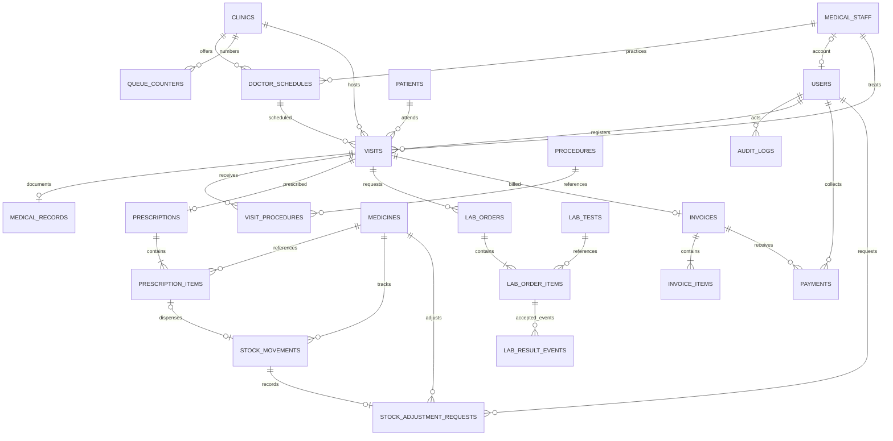

# Database design

PostgreSQL, 22 baseline domain tables + login_attempts + stock_adjustment_requests (24 application tables), 5 reporting views, plus Yii migration metadata. `database/schema.sql` is the column-level baseline. Install through the three Yii migrations; the baseline is not a separate installation route. IDs bigint identity, monetary values integer IDR bigint, timestamps timestamptz, visit_date in Asia/Jakarta. Three dedicated sequences generate MRN, invoice and receipt references (gaps are acceptable; queue numbers are separate transactional counters).

For legibility the diagram omits some actor FKs (medical record, stock, prescription, lab, invoice); SQL is authoritative. Invoice item source is category-specific and validated by service, not a polymorphic FK. Roles are a fixed checked value in users rather than an unnecessary roles table. Doctors and other medical staff share a master with profession; Yii validates doctor-only references.

| Table group | Table and role |
|---|---|
| Identity | users (credentials/role/token version), patients (MRN/identity), medical_staff (doctors and other staff) |
| Masters | clinics (registration fee), doctor_schedules, procedures, medicines (stock & price), lab_tests |
| Registration | queue_counters (clinic/date), visits (patient/doctor/clinic/schedule, status & fee snapshot) |
| Clinical | medical_records (one per visit/version), visit_procedures (many with price snapshots) |
| Pharmacy | prescriptions, prescription_items, stock_movements (ledger) |
| Laboratory | lab_orders, lab_order_items, lab_result_events (idempotency ledger) |
| Finance | invoices (one per visit/revision), invoice_items (price snapshots), payments (unique key/receipt) |
| Audit | audit_logs (actor, reason, before/after, request_id) |

## Constraints and invariants

- Unique MRN and non-null identity_no, master codes, normalized usernames. All referenced history is protected by FK default NO ACTION; soft deactivation when in use.
- Composite schedule FK on visits matches doctor and clinic; service validates active, weekday and doctor profession; schedule overlap checked with staff row lock.
- Visit uniqueness patient/clinic/date and queue uniqueness clinic/date/number; counter primary key clinic/date.
- Nonnegative stock and prices, positive quantities/payment, nonnegative invoice total, one record/prescription/invoice per visit. Stock balance changes only via transactional stock ledger; DB constraint alone does not ensure movement reconciliation.
- Unique payment idempotency key and lab event key. Overpayment and valid state transitions are service invariants protected by row locks, not implicit SQL CHECKs across tables.
- Payment status derived from committed sums. Invoice total and item sum invariant checked when rebuilding invoice under lock. Immutable prices copied into transactional lines.
- Record version and invoice revision guard against stale writes. Migration 000003 enforces append-only access for core runtime on audit_logs, payments, stock_movements, lab_result_events and stock_adjustment_requests. The owner retains administrative power.

## Reporting views and indexes

`reporting.visits`, `reporting.procedures`, `reporting.revenue`, `reporting.medicine_usage`, `reporting.invoice_status` expose non-clinical rows. Node receives read grants only on these views. SQL defines indexes for visit date/clinic, doctor queue, patient history, lower-case prefix name search, schedule, pending prescriptions/lab, lab visit, payments by invoice/date, inventory movements by date and entity audit. Use query plans to confirm actual use rather than assuming every index improves performance.

## Foundation implementation delta

`login_attempts(bucket PK, window_start, attempts)` is an auth infrastructure table without foreign keys; it tracks hashed username/IP and IP throttle buckets. Yii migration metadata is not a domain table. Domain schema stays unchanged.

## Migration deltas (Phase 2–9)
The Phase 1 baseline remains unchanged. Migration 000001 adds `login_attempts`. Migration 000002 adds reporting indexes and replaces the invoice reporting view. Migration 000003 adds `stock_adjustment_requests` (`event_key` UUID PK, `medicine_id` FK, `actor_id` FK, `payload_hash`, `movement_id` unique FK to `stock_movements`, `created_at`) and an index for billing queue; it restricts Core ledger permissions. One adjustment key identifies exactly one movement; a movement has at most one request key. Legacy movements need no backfill. Apply all Yii migrations; do not apply this schema file independently to an existing DB.

`lab_orders.visit_id` is not unique in baseline SQL; one order per visit is an application invariant enforced under the visit lock. `login_attempts` is standalone. See the SQL and migration files for exact column constraints.

Standalone diagram: [SVG logical ERD](diagrams/erd.svg) (editable [DOT source](diagrams/erd.dot)). See Mermaid and SQL for exact constraints.

### v1.0.1 schema addendum

Migration `m261124_000004_master_codes` adds five independent PostgreSQL sequences for generated master codes. No table columns, relationships, historical identifiers, or existing constraints are changed. Core receives USAGE/SELECT only on these new sequences; the reporting role receives none. Existing table `audit_logs` supports section history through the indexed entity lookup.
