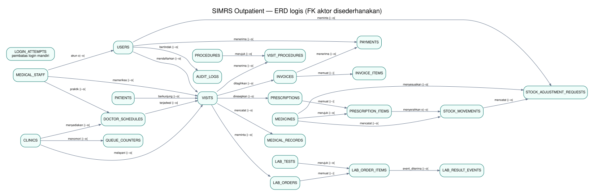
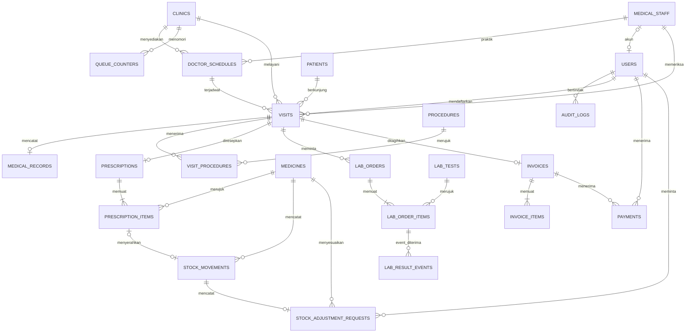

# Desain basis data dan ERD

PostgreSQL: 22 tabel domain awal, `login_attempts` dan `stock_adjustment_requests` (24 tabel aplikasi), lima view pelaporan serta tabel metadata migration Yii. Fingerprint upgrade mencakup 23 tabel bisnis, tidak termasuk `login_attempts` dan metadata migration. ID bigint, Rupiah bigint, timestamp `timestamptz`, tanggal kunjungan WIB. Sequence rekam medis, invoice dan bukti pembayaran terpisah dari counter antrean. Instalasi melalui empat migration Yii; `database/schema.sql` adalah schema awal, bukan instalasi tambahan.

Diagram menyederhanakan FK aktor untuk keterbacaan; SQL dan migration adalah acuan constraint lengkap. Sumber invoice item ditentukan kategori dan divalidasi service, bukan FK polimorfik. Peran adalah nilai terbatas pada `users`.

| Kelompok | Tabel dan fungsi |
|---|---|
| Identitas | `users`, `patients`, `medical_staff` |
| Master | `clinics`, `doctor_schedules`, `procedures`, `medicines`, `lab_tests` |
| Kunjungan | `queue_counters` per poli/tanggal, `visits` dengan snapshot biaya |
| Klinis | `medical_records` satu per kunjungan dengan versi, `visit_procedures` dengan snapshot harga |
| Farmasi | `prescriptions`, `prescription_items`, `stock_movements`, `stock_adjustment_requests` |
| Lab | `lab_orders`, `lab_order_items`, `lab_result_events` |
| Keuangan | `invoices` satu per kunjungan/revisi, `invoice_items`, `payments` |
| Audit dan autentikasi | `audit_logs`, `login_attempts` untuk pembatasan login |

## Constraint dan invariant

- Nomor RM, kode master, username ternormalisasi dan `identity_no` non-null unik. FK melindungi riwayat; data berreferensi dapat dinonaktifkan, tidak dihapus paksa.
- FK komposit jadwal memastikan dokter dan poli sesuai. Service memvalidasi profesi, status aktif, hari dan tumpang tindih jadwal dengan lock tenaga medis.
- Unik `(patient_id,clinic_id,visit_date)` dan `(clinic_id,visit_date,queue_number)`. Counter memiliki PK poli/tanggal.
- Stok/harga nonnegatif, kuantitas/pembayaran positif. Satu rekam medis, resep dan invoice per kunjungan. Satu order lab per kunjungan adalah invariant service dengan visit lock, bukan unique constraint baseline.
- Kunci idempotency pembayaran dan lab unik. Overpayment dicegah service di bawah lock; constraint lintas tabel tidak diasumsikan sebagai CHECK.
- Total invoice sama dengan jumlah item; tarif transaksi menggunakan snapshot. Versi klinis dan revisi invoice mencegah penulisan stale. Ledger audit, pembayaran, stok, event lab, dan penyesuaian stok append-only bagi akun runtime Core; owner tetap berwenang secara administratif.

## View dan indeks

`reporting.visits`, `reporting.procedures`, `reporting.revenue`, `reporting.medicine_usage`, `reporting.invoice_status` hanya mengekspos data nonklinis. Indeks untuk tanggal/poli, antrean dokter, riwayat pasien, pencarian prefix, jadwal, status resep/lab, pembayaran invoice/tanggal, mutasi stok, audit entitas. Gunakan EXPLAIN ANALYZE untuk verifikasi; indeks biasa belum tentu membantu pencarian contains.

## Migration

| Nomor | Perubahan |
|---|---|
| 000001 | Schema awal, hak akses, `login_attempts(bucket,window_start,attempts)` |
| 000002 | Indeks pelaporan dan penggantian view invoice per invoice |
| 000003 | Ledger `stock_adjustment_requests(event_key,medicine_id,actor_id,payload_hash,movement_id,created_at)`, indeks billing, pembatasan perubahan ledger |
| 000004 | Sequence `staff_code_seq`, `clinic_code_seq`, `procedure_code_seq`, `medicine_code_seq`, `lab_test_code_seq`; USAGE/SELECT untuk Core |

Migration 000004 tidak mengubah baris bisnis atau nomor lama, dan `safeDown` menolak rollback setelah sequence dipakai. Upgrade aktual dari v1.0.0 membuktikan fingerprint 23 tabel tetap identik. Backup/restore tetap diperlukan; fingerprint tidak mencakup semua properti database. Lihat [schema](../database/schema.sql), [migration](../backend-yii/migrations/) dan [panduan upgrade](UPGRADE_V1.1.0.md).
