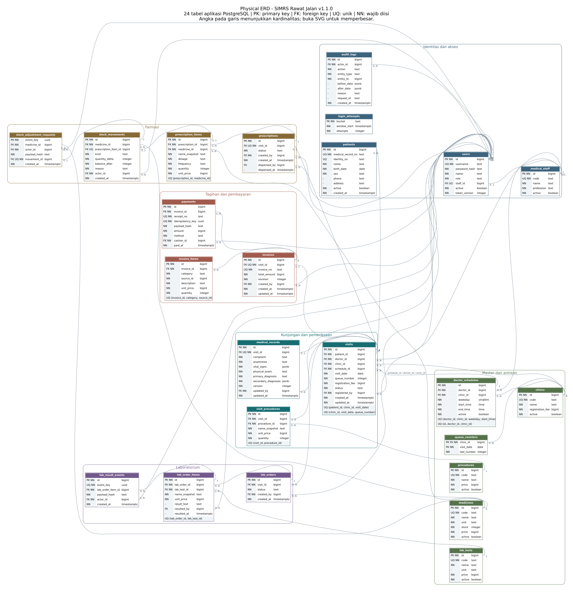

# Desain fisik database

Diagram ini menunjukkan nama tabel, kolom, tipe data PostgreSQL, primary key (PK), foreign key (FK), unique constraint (UQ), dan kolom wajib (NN). Klik gambar untuk memperbesar.

[Buka Physical ERD (SVG)](diagrams/physical-erd.svg) · [Sumber diagram](diagrams/physical-erd.dot) · [ERD ringkas](ERD.md)

## Cakupan

Disusun dari [schema awal](../database/schema.sql) dan [empat migration](../backend-yii/migrations/) v1.1.0: **24 tabel aplikasi, 171 kolom, 37 foreign key** (FK komposit dihitung satu constraint). Ini adalah desain berdasarkan source SQL, bukan hasil ekspor langsung dari database MacBook.

Metadata `migration` milik Yii tidak termasuk tabel aplikasi. Lima view pada schema `reporting` bukan tabel fisik; migration 000002 memperbarui view tagihan dan indeks. Migration 000004 menambahkan lima sequence kode master tanpa perubahan kolom.

Kardinalitas mengikuti constraint SQL, bukan aturan layanan. Misalnya, satu kunjungan hanya boleh memiliki satu order lab menurut logika layanan, tetapi database tidak menetapkan UNIQUE pada `lab_orders.visit_id`. Kolom `invoice_items.source_id` dan `audit_logs.entity_id` bukan FK.

## Diagram per bagian

Jika gambar lengkap terlalu padat, buka diagram per bagian berikut. Kotak referensi hanya menampilkan kolom yang dirujuk dari kelompok lain.

- [Identitas dan akses](diagrams/physical-erd-identitas.svg) · [Sumber DOT](diagrams/physical-erd-identitas.dot)
- [Master dan antrean](diagrams/physical-erd-master.svg) · [Sumber DOT](diagrams/physical-erd-master.dot)
- [Kunjungan dan pemeriksaan](diagrams/physical-erd-klinis.svg) · [Sumber DOT](diagrams/physical-erd-klinis.dot)
- [Farmasi](diagrams/physical-erd-farmasi.svg) · [Sumber DOT](diagrams/physical-erd-farmasi.dot)
- [Laboratorium](diagrams/physical-erd-lab.svg) · [Sumber DOT](diagrams/physical-erd-lab.dot)
- [Tagihan dan pembayaran](diagrams/physical-erd-billing.svg) · [Sumber DOT](diagrams/physical-erd-billing.dot)

## Rincian kolom dan aturan SQL

Bagian ini melengkapi gambar dengan default, CHECK, FK komposit dan constraint lainnya. SQL dan migration tetap menjadi acuan utama.

### Identitas dan akses

#### `medical_staff`

| Kolom | Tipe | Definisi setelah tipe |
|---|---|---|
| `id` | `bigint` | `GENERATED ALWAYS AS IDENTITY PRIMARY KEY` |
| `code` | `text` | `NOT NULL UNIQUE` |
| `name` | `text` | `NOT NULL` |
| `profession` | `text` | `NOT NULL CHECK (profession IN ('doctor','nurse','other'))` |
| `active` | `boolean` | `NOT NULL DEFAULT true` |

#### `users`

| Kolom | Tipe | Definisi setelah tipe |
|---|---|---|
| `id` | `bigint` | `GENERATED ALWAYS AS IDENTITY PRIMARY KEY` |
| `username` | `text` | `NOT NULL UNIQUE CHECK (username = lower(username))` |
| `password_hash` | `text` | `NOT NULL` |
| `name` | `text` | `NOT NULL` |
| `role` | `text` | `NOT NULL CHECK (role IN ('admin','registration','doctor','pharmacy','laboratory','cashier'))` |
| `staff_id` | `bigint` | `UNIQUE REFERENCES medical_staff(id)` |
| `active` | `boolean` | `NOT NULL DEFAULT true` |
| `token_version` | `integer` | `NOT NULL DEFAULT 0` |

Aturan tingkat tabel:

- `CHECK (role <> 'doctor' OR staff_id IS NOT NULL)`

#### `patients`

| Kolom | Tipe | Definisi setelah tipe |
|---|---|---|
| `id` | `bigint` | `GENERATED ALWAYS AS IDENTITY PRIMARY KEY` |
| `medical_record_no` | `text` | `NOT NULL UNIQUE` |
| `identity_no` | `text` | `UNIQUE` |
| `name` | `text` | `NOT NULL` |
| `birth_date` | `date` | `NOT NULL` |
| `sex` | `text` | `NOT NULL CHECK (sex IN ('M','F','U'))` |
| `phone` | `text` | Boleh kosong |
| `address` | `text` | Boleh kosong |
| `active` | `boolean` | `NOT NULL DEFAULT true` |
| `created_at` | `timestamptz` | `NOT NULL DEFAULT now()` |

Aturan tingkat tabel:

- `CHECK (identity_no IS NULL OR length(trim(identity_no)) > 0)`

#### `login_attempts`

| Kolom | Tipe | Definisi setelah tipe |
|---|---|---|
| `bucket` | `text` | `PRIMARY KEY` |
| `window_start` | `timestamptz` | `NOT NULL` |
| `attempts` | `integer` | `NOT NULL CHECK (attempts > 0)` |

#### `audit_logs`

| Kolom | Tipe | Definisi setelah tipe |
|---|---|---|
| `id` | `bigint` | `GENERATED ALWAYS AS IDENTITY PRIMARY KEY` |
| `actor_id` | `bigint` | `NOT NULL REFERENCES users(id)` |
| `action` | `text` | `NOT NULL` |
| `entity_type` | `text` | `NOT NULL` |
| `entity_id` | `bigint` | `NOT NULL` |
| `before_data` | `jsonb` | Boleh kosong |
| `after_data` | `jsonb` | Boleh kosong |
| `reason` | `text` | Boleh kosong |
| `request_id` | `text` | Boleh kosong |
| `created_at` | `timestamptz` | `NOT NULL DEFAULT now()` |

### Master dan antrean

#### `clinics`

| Kolom | Tipe | Definisi setelah tipe |
|---|---|---|
| `id` | `bigint` | `GENERATED ALWAYS AS IDENTITY PRIMARY KEY` |
| `code` | `text` | `NOT NULL UNIQUE` |
| `name` | `text` | `NOT NULL` |
| `registration_fee` | `bigint` | `NOT NULL CHECK (registration_fee >= 0)` |
| `active` | `boolean` | `NOT NULL DEFAULT true` |

#### `doctor_schedules`

| Kolom | Tipe | Definisi setelah tipe |
|---|---|---|
| `id` | `bigint` | `GENERATED ALWAYS AS IDENTITY PRIMARY KEY` |
| `doctor_id` | `bigint` | `NOT NULL REFERENCES medical_staff(id)` |
| `clinic_id` | `bigint` | `NOT NULL REFERENCES clinics(id)` |
| `weekday` | `smallint` | `NOT NULL CHECK (weekday BETWEEN 1 AND 7)` |
| `start_time` | `time` | `NOT NULL` |
| `end_time` | `time` | `NOT NULL` |
| `active` | `boolean` | `NOT NULL DEFAULT true` |

Aturan tingkat tabel:

- `CHECK (start_time < end_time)`
- `UNIQUE (doctor_id,clinic_id,weekday,start_time)`
- `UNIQUE (id,doctor_id,clinic_id)`

#### `queue_counters`

| Kolom | Tipe | Definisi setelah tipe |
|---|---|---|
| `clinic_id` | `bigint` | `NOT NULL REFERENCES clinics(id)` |
| `visit_date` | `date` | `NOT NULL` |
| `last_number` | `integer` | `NOT NULL CHECK (last_number > 0)` |

Aturan tingkat tabel:

- `PRIMARY KEY (clinic_id,visit_date)`

#### `procedures`

| Kolom | Tipe | Definisi setelah tipe |
|---|---|---|
| `id` | `bigint` | `GENERATED ALWAYS AS IDENTITY PRIMARY KEY` |
| `code` | `text` | `NOT NULL UNIQUE` |
| `name` | `text` | `NOT NULL` |
| `price` | `bigint` | `NOT NULL CHECK (price >= 0)` |
| `active` | `boolean` | `NOT NULL DEFAULT true` |

#### `medicines`

| Kolom | Tipe | Definisi setelah tipe |
|---|---|---|
| `id` | `bigint` | `GENERATED ALWAYS AS IDENTITY PRIMARY KEY` |
| `code` | `text` | `NOT NULL UNIQUE` |
| `name` | `text` | `NOT NULL` |
| `unit` | `text` | `NOT NULL` |
| `stock` | `integer` | `NOT NULL DEFAULT 0 CHECK (stock >= 0)` |
| `price` | `bigint` | `NOT NULL CHECK (price >= 0)` |
| `active` | `boolean` | `NOT NULL DEFAULT true` |

#### `lab_tests`

| Kolom | Tipe | Definisi setelah tipe |
|---|---|---|
| `id` | `bigint` | `GENERATED ALWAYS AS IDENTITY PRIMARY KEY` |
| `code` | `text` | `NOT NULL UNIQUE` |
| `name` | `text` | `NOT NULL` |
| `unit` | `text` | Boleh kosong |
| `price` | `bigint` | `NOT NULL CHECK (price >= 0)` |
| `active` | `boolean` | `NOT NULL DEFAULT true` |

### Kunjungan dan pemeriksaan

#### `visits`

| Kolom | Tipe | Definisi setelah tipe |
|---|---|---|
| `id` | `bigint` | `GENERATED ALWAYS AS IDENTITY PRIMARY KEY` |
| `patient_id` | `bigint` | `NOT NULL REFERENCES patients(id)` |
| `doctor_id` | `bigint` | `NOT NULL REFERENCES medical_staff(id)` |
| `clinic_id` | `bigint` | `NOT NULL REFERENCES clinics(id)` |
| `schedule_id` | `bigint` | `NOT NULL` |
| `visit_date` | `date` | `NOT NULL` |
| `queue_number` | `integer` | `NOT NULL CHECK (queue_number > 0)` |
| `registration_fee` | `bigint` | `NOT NULL CHECK (registration_fee >= 0)` |
| `status` | `text` | `NOT NULL DEFAULT 'waiting' CHECK (status IN ('waiting','in_exam','services_pending','ready_for_billing','completed'))` |
| `registered_by` | `bigint` | `NOT NULL REFERENCES users(id)` |
| `created_at` | `timestamptz` | `NOT NULL DEFAULT now()` |
| `updated_at` | `timestamptz` | `NOT NULL DEFAULT now()` |

Aturan tingkat tabel:

- `FOREIGN KEY (schedule_id,doctor_id,clinic_id) REFERENCES doctor_schedules(id,doctor_id,clinic_id)`
- `UNIQUE (patient_id,clinic_id,visit_date)`
- `UNIQUE (clinic_id,visit_date,queue_number)`

#### `medical_records`

| Kolom | Tipe | Definisi setelah tipe |
|---|---|---|
| `id` | `bigint` | `GENERATED ALWAYS AS IDENTITY PRIMARY KEY` |
| `visit_id` | `bigint` | `NOT NULL UNIQUE REFERENCES visits(id)` |
| `complaint` | `text` | `NOT NULL` |
| `anamnesis` | `text` | `NOT NULL` |
| `vital_signs` | `jsonb` | `NOT NULL CHECK (jsonb_typeof(vital_signs) = 'object')` |
| `physical_exam` | `text` | `NOT NULL` |
| `primary_diagnosis` | `text` | `NOT NULL` |
| `secondary_diagnoses` | `jsonb` | `NOT NULL DEFAULT '[]' CHECK (jsonb_typeof(secondary_diagnoses) = 'array')` |
| `version` | `integer` | `NOT NULL DEFAULT 1 CHECK (version > 0)` |
| `updated_by` | `bigint` | `NOT NULL REFERENCES users(id)` |
| `updated_at` | `timestamptz` | `NOT NULL DEFAULT now()` |

#### `visit_procedures`

| Kolom | Tipe | Definisi setelah tipe |
|---|---|---|
| `id` | `bigint` | `GENERATED ALWAYS AS IDENTITY PRIMARY KEY` |
| `visit_id` | `bigint` | `NOT NULL REFERENCES visits(id)` |
| `procedure_id` | `bigint` | `NOT NULL REFERENCES procedures(id)` |
| `name_snapshot` | `text` | `NOT NULL` |
| `unit_price` | `bigint` | `NOT NULL CHECK (unit_price >= 0)` |
| `quantity` | `integer` | `NOT NULL CHECK (quantity > 0)` |

Aturan tingkat tabel:

- `UNIQUE (visit_id,procedure_id)`

### Farmasi

#### `prescriptions`

| Kolom | Tipe | Definisi setelah tipe |
|---|---|---|
| `id` | `bigint` | `GENERATED ALWAYS AS IDENTITY PRIMARY KEY` |
| `visit_id` | `bigint` | `NOT NULL UNIQUE REFERENCES visits(id)` |
| `status` | `text` | `NOT NULL DEFAULT 'pending' CHECK (status IN ('pending','dispensed'))` |
| `created_by` | `bigint` | `NOT NULL REFERENCES users(id)` |
| `created_at` | `timestamptz` | `NOT NULL DEFAULT now()` |
| `dispensed_by` | `bigint` | `REFERENCES users(id)` |
| `dispensed_at` | `timestamptz` | Boleh kosong |

Aturan tingkat tabel:

- `CHECK ((status = 'dispensed') = (dispensed_by IS NOT NULL AND dispensed_at IS NOT NULL))`

#### `prescription_items`

| Kolom | Tipe | Definisi setelah tipe |
|---|---|---|
| `id` | `bigint` | `GENERATED ALWAYS AS IDENTITY PRIMARY KEY` |
| `prescription_id` | `bigint` | `NOT NULL REFERENCES prescriptions(id)` |
| `medicine_id` | `bigint` | `NOT NULL REFERENCES medicines(id)` |
| `name_snapshot` | `text` | `NOT NULL` |
| `dosage` | `text` | `NOT NULL` |
| `frequency` | `text` | `NOT NULL` |
| `quantity` | `integer` | `NOT NULL CHECK (quantity > 0)` |
| `unit_price` | `bigint` | `NOT NULL CHECK (unit_price >= 0)` |

Aturan tingkat tabel:

- `UNIQUE (prescription_id,medicine_id)`

#### `stock_movements`

| Kolom | Tipe | Definisi setelah tipe |
|---|---|---|
| `id` | `bigint` | `GENERATED ALWAYS AS IDENTITY PRIMARY KEY` |
| `medicine_id` | `bigint` | `NOT NULL REFERENCES medicines(id)` |
| `prescription_item_id` | `bigint` | `UNIQUE REFERENCES prescription_items(id)` |
| `kind` | `text` | `NOT NULL CHECK (kind IN ('opening','adjustment','dispense'))` |
| `quantity_delta` | `integer` | `NOT NULL CHECK (quantity_delta <> 0)` |
| `balance_after` | `integer` | `NOT NULL CHECK (balance_after >= 0)` |
| `reason` | `text` | `NOT NULL` |
| `actor_id` | `bigint` | `NOT NULL REFERENCES users(id)` |
| `created_at` | `timestamptz` | `NOT NULL DEFAULT now()` |

Aturan tingkat tabel:

- `CHECK ((kind = 'dispense' AND quantity_delta < 0 AND prescription_item_id IS NOT NULL) OR (kind <> 'dispense' AND prescription_item_id IS NULL))`
- `CHECK (kind <> 'opening' OR quantity_delta > 0)`

#### `stock_adjustment_requests`

| Kolom | Tipe | Definisi setelah tipe |
|---|---|---|
| `event_key` | `uuid` | `PRIMARY KEY` |
| `medicine_id` | `bigint` | `NOT NULL REFERENCES medicines(id)` |
| `actor_id` | `bigint` | `NOT NULL REFERENCES users(id)` |
| `payload_hash` | `text` | `NOT NULL` |
| `movement_id` | `bigint` | `NOT NULL UNIQUE REFERENCES stock_movements(id)` |
| `created_at` | `timestamptz` | `NOT NULL DEFAULT now()` |

### Laboratorium

#### `lab_orders`

| Kolom | Tipe | Definisi setelah tipe |
|---|---|---|
| `id` | `bigint` | `GENERATED ALWAYS AS IDENTITY PRIMARY KEY` |
| `visit_id` | `bigint` | `NOT NULL REFERENCES visits(id)` |
| `status` | `text` | `NOT NULL DEFAULT 'pending' CHECK (status IN ('pending','completed'))` |
| `created_by` | `bigint` | `NOT NULL REFERENCES users(id)` |
| `created_at` | `timestamptz` | `NOT NULL DEFAULT now()` |

#### `lab_order_items`

| Kolom | Tipe | Definisi setelah tipe |
|---|---|---|
| `id` | `bigint` | `GENERATED ALWAYS AS IDENTITY PRIMARY KEY` |
| `lab_order_id` | `bigint` | `NOT NULL REFERENCES lab_orders(id)` |
| `lab_test_id` | `bigint` | `NOT NULL REFERENCES lab_tests(id)` |
| `name_snapshot` | `text` | `NOT NULL` |
| `unit_price` | `bigint` | `NOT NULL CHECK (unit_price >= 0)` |
| `result_text` | `text` | Boleh kosong |
| `resulted_by` | `bigint` | `REFERENCES users(id)` |
| `resulted_at` | `timestamptz` | Boleh kosong |

Aturan tingkat tabel:

- `UNIQUE (lab_order_id,lab_test_id)`
- `CHECK ((result_text IS NULL AND resulted_by IS NULL AND resulted_at IS NULL) OR (result_text IS NOT NULL AND resulted_by IS NOT NULL AND resulted_at IS NOT NULL))`

#### `lab_result_events`

| Kolom | Tipe | Definisi setelah tipe |
|---|---|---|
| `id` | `bigint` | `GENERATED ALWAYS AS IDENTITY PRIMARY KEY` |
| `event_key` | `uuid` | `NOT NULL UNIQUE` |
| `lab_order_item_id` | `bigint` | `NOT NULL REFERENCES lab_order_items(id)` |
| `payload_hash` | `text` | `NOT NULL` |
| `actor_id` | `bigint` | `NOT NULL REFERENCES users(id)` |
| `created_at` | `timestamptz` | `NOT NULL DEFAULT now()` |

### Tagihan dan pembayaran

#### `invoices`

| Kolom | Tipe | Definisi setelah tipe |
|---|---|---|
| `id` | `bigint` | `GENERATED ALWAYS AS IDENTITY PRIMARY KEY` |
| `visit_id` | `bigint` | `NOT NULL UNIQUE REFERENCES visits(id)` |
| `invoice_no` | `text` | `NOT NULL UNIQUE` |
| `total_amount` | `bigint` | `NOT NULL CHECK (total_amount >= 0)` |
| `revision` | `integer` | `NOT NULL DEFAULT 1 CHECK (revision > 0)` |
| `created_by` | `bigint` | `NOT NULL REFERENCES users(id)` |
| `created_at` | `timestamptz` | `NOT NULL DEFAULT now()` |
| `updated_at` | `timestamptz` | `NOT NULL DEFAULT now()` |

#### `invoice_items`

| Kolom | Tipe | Definisi setelah tipe |
|---|---|---|
| `id` | `bigint` | `GENERATED ALWAYS AS IDENTITY PRIMARY KEY` |
| `invoice_id` | `bigint` | `NOT NULL REFERENCES invoices(id)` |
| `category` | `text` | `NOT NULL CHECK (category IN ('registration','procedure','laboratory','medicine'))` |
| `source_id` | `bigint` | `NOT NULL` |
| `description` | `text` | `NOT NULL` |
| `unit_price` | `bigint` | `NOT NULL CHECK (unit_price >= 0)` |
| `quantity` | `integer` | `NOT NULL CHECK (quantity > 0)` |

Aturan tingkat tabel:

- `UNIQUE (invoice_id,category,source_id)`

#### `payments`

| Kolom | Tipe | Definisi setelah tipe |
|---|---|---|
| `id` | `bigint` | `GENERATED ALWAYS AS IDENTITY PRIMARY KEY` |
| `invoice_id` | `bigint` | `NOT NULL REFERENCES invoices(id)` |
| `receipt_no` | `text` | `NOT NULL UNIQUE` |
| `idempotency_key` | `uuid` | `NOT NULL UNIQUE` |
| `payload_hash` | `text` | `NOT NULL` |
| `amount` | `bigint` | `NOT NULL CHECK (amount > 0)` |
| `method` | `text` | `NOT NULL CHECK (method IN ('cash','non_cash'))` |
| `cashier_id` | `bigint` | `NOT NULL REFERENCES users(id)` |
| `paid_at` | `timestamptz` | `NOT NULL DEFAULT now()` |

