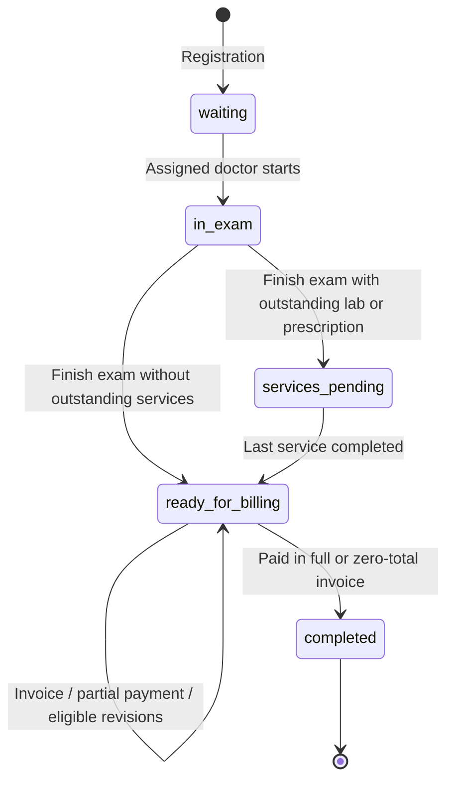

# Business workflow & transaction design



## Workflow rules

- Register today in Asia/Jakarta (server clock), choose active schedule for that weekday, matching doctor and clinic; bookings can occur before scheduled time on that day. Queue numbers increase per clinic/date. One visit per patient/clinic/date (MVP policy, not a universal hospital rule). Revisit/cancel workflow not modeled.
- Assigned doctor starts visit and saves EMR. Vital signs JSON keys: `systolic`, `diastolic` (mmHg), `pulse` (bpm), `temperature` (C), `respiratory_rate` (per min), `weight` (kg); numeric with reasonable validation, no clinical diagnostic automation. Required complaint, anamnesis, physical exam and primary diagnosis; secondary diagnoses array. Record versions prevent silent overwrites.
- Doctor initially selects procedures, prescription and lab orders in `in_exam`; the procedure revision exception for unpaid invoices is documented below. Multiple procedure quantities, one prescription with one line per drug, one lab order containing multiple tests per visit (Phase 6 MVP). Validate quantities, existence and active masters. Snapshots capture names/prices on line creation; existing price snapshots retained when quantity changes. Draft prescription may be edited only before examination finish; no empty saved prescription/order. Lab order results may be entered while exam is open or services are pending; lab order edits lock after the first result. Pharmacy dispensing is only after exam finish. No mandatory prescription or lab order for visits without indications.
- Finish exam requires a complete record. If any lab order or prescription is pending -> `services_pending`; else `ready_for_billing`. Each completed service recalculates status under visit lock, but does not advance an `in_exam` visit. Lab result completion requires all items filled. Completed result is immutable in MVP; correction workflow is future work.
- Invoice can be generated only when ready; sources: registration fee from visit, procedure snapshots, completed lab item snapshots, dispensed prescription item snapshots. `invoice_items.source_id` points to the corresponding source by category, enforced by service (polymorphic FK not supported by SQL). Each category/source pair unique. Total is sum of price * quantity with bounded checked integer arithmetic. Invoice number/receipt number derived from database-assigned identity or separate atomic sequence, never MAX+1. Generate endpoint is idempotent per visit. Zero-total invoice immediately closes the visit and has no payment receipt.
- Partial payment leaves visit ready; payment status derived from sum of committed payments vs invoice total (no second mutable payment status). Full payment closes visit. Cash/non_cash are simulated; no external gateway. Reject amounts <=0 and > outstanding; no refunds or change handling in MVP.
- Doctor can amend diagnosis (reason and optimistic version required) after invoice creation including completed visits; audit only, no financial change. Procedure amendment permitted in ready state only while no payment exists; same transaction updates procedure list, invoice items/total/revision and audit. If revision total becomes zero, close visit. Once any payment exists or visit completed, reject financial edits with `BILLING_LOCKED`; adjustment/refund functionality outside MVP. Cashier must send expected invoice revision on payment to avoid paying stale totals.
- Patient history retained across master changes; inactive items not selectable for new transactions. Existing valid transactions can finish even if a master is deactivated. Admin stock changes use adjustment endpoint with reason and movement, not generic CRUD overwrite.

## D1 — Concurrent registration

Yii transaction: validate patient/schedule; upsert atomic queue counter, insert visit with snapshot; catch SQLSTATE 23505 for relevant constraint and return 409 `DUPLICATE_VISIT` or `QUEUE_CONFLICT` (do not expose SQL errors). Roll back counter when insert fails.

```sql
INSERT INTO queue_counters (clinic_id, visit_date, last_number)
VALUES (:clinic, :date, 1)
ON CONFLICT (clinic_id, visit_date) DO UPDATE
SET last_number = queue_counters.last_number + 1
RETURNING last_number;
```

Unique `(patient_id,clinic_id,visit_date)` prevents duplicate visit; unique `(clinic_id,visit_date,queue_number)` prevents duplicate queue. Parallel different patients get distinct numbers. Retry deadlock/serialization failures only boundedly after rollback.

## D2 — Concurrent stock

Lock order: shared master guard -> visit -> medicine IDs ascending. Prescription serialization comes from the visit lock. Recheck pending status; repeat dispense returns existing state without side effects. All lines in one transaction; use conditional update per medicine, check one affected row, insert stock movement with resulting balance. Any insufficient stock rolls back every line and state change. Prescription-time stock check is advisory, not reservation. Positive/negative stock adjustment uses transactional stock movement and a UUID retry ledger (Phase 9). DB CHECK stock >=0 and unique movement per prescription item are additional safeguards.

```sql
UPDATE medicines SET stock = stock - :qty
WHERE id = :id AND stock >= :qty RETURNING stock;
```

## D3 — Idempotent payment

Client generates UUID for each payment intent, retains until definitive outcome, and reuses identical body/key on timeout. Never auto-generate a new key for retry. Yii begins transaction, locks visit then invoice, checks existing key first (even if invoice now paid); same invoice/cashier/amount/method/revision fingerprint -> return existing receipt with 200; different fingerprint -> 409. For new key verify expected revision, visit state and remaining balance; insert unique key and receipt, mark visit completed when balance 0; commit before response. Payment key advisory lock and unique constraint serialize same-key requests across invoices; mismatch rejected without revealing another cashier's payment. Different keys on same invoice serialized. Key protects a retry, not a new intentional payment with a new key. UI provides receipt lookup for ambiguous outcome before new payment.

## D4 — Changes after billing

Lock visit first then invoice, check payments under same lock. Procedure modification and invoice rebuild in single transaction; increment revision; audit before/after and reason. Reject fee-affecting updates after first payment; diagnosis-only changes versioned and audited. Cashier with stale invoice revision gets 409 `STALE_INVOICE`. Admin cannot bypass service constraints.

## D5 — Integration failure

Node validates/forwards lab event UUID and original bearer. Yii takes an event-key advisory lock then locks the visit; checks event ledger and fingerprint; saves result, event and status in same transaction. Repeat accepted event returns current order snapshot without side effects. A different event for already finalized item -> 409. Node 503 on ambiguous upstream failure; sender retains payload/key and retries. Core UI can use Yii directly, Node dashboard shows error; no cross-service distributed write transaction. See architecture for sender persistence limitation.

## D6 — Performance

Use server-side pagination with stable ID tie-breaker (20 default, 100 max), indexed clinic/date, doctor/date/status, MRN/identity, patient history and payment dates. Current master/visit search uses case-insensitive contains; ordinary prefix indexes may not serve these queries. At scale measure with actual plans and consider trigram indexes or prefix search if warranted. Fetch joined/aggregated rows rather than N+1. Dashboard reads dedicated views in read-only repeatable-read transaction for consistent totals; filter by date using index-compatible ranges, do not cast timestamp column. Measure with synthetic data and EXPLAIN (ANALYZE, BUFFERS), document actual plan/time; no performance claim yet.

## Shared transaction and audit rules

Workflow writes serialize on the visit before domain rows. Shared master guard precedes visit locks where applicable; lab event key lock precedes the visit, payment key lock follows visit and invoice. Inventory rows are processed in sorted ID order. No external HTTP requests while holding DB locks. Prices, quantities, actor and status always verified server-side. Audit sensitive modifications (EMR, actions, invoice, stock, users) in same transaction; never include password hashes/tokens in audit JSON. Audit records have restricted access and contain dummy clinical data only during evaluation. Use fixed request ID, expected versions and stable domain error codes.

### Phase 4 implementation detail

Registration acquires `pg_advisory_xact_lock_shared(682361,1)` before validating active master records; master mutations from Phase 3 use the exclusive lock on the same key. This permits concurrent registrations but prevents master edits during validation/insert through these services. Per-clinic/day counter upsert is in the same transaction as visit creation and audit. Targeted `ON CONFLICT(patient_id,clinic_id,visit_date) DO NOTHING RETURNING id` distinguishes duplicate visits; unique queue collisions return 409. Both roll back counter advancement. Two bounded retries for SQLSTATE 40001/40P01. Start examination locks assigned visit row; already-in_exam is a side-effect-free replay.

### Phase 5 implementation detail

EMR, procedures and finish share `medical_records.version` (record must exist before procedure edits). Every write locks the assigned visit and compares expected_version, then increments version atomically; clinical writes use the same lock order that later pharmacy/lab/billing must respect. Procedure updates take the shared master advisory lock before the visit lock to coordinate price snapshots. Existing line name/price snapshots and IDs remain unchanged when quantity changes; new items capture current active master values. The full procedure replacement validates before writing. Audit and mutation commit together. Finish checks pending prescription/lab and chooses services_pending or ready_for_billing; actual pending services creation arrives Phase 6. Diagnosis-only amendments after finish are versioned and audited; all financial edits after finish are blocked for now. Phase 7 must implement unpaid invoice revision atomically under visit/invoice lock as planned in D4.

Phase 6: both ancillary draft replacements share `medical_records.version`. The visit row serializes draft edits, examination finish, dispensing and result storage. Lab results during `in_exam` never advance the visit prematurely. When all pending orders are complete after exam finish, transition to `ready_for_billing` occurs in the same transaction. No new migration; baseline stock check and movement/event uniqueness are used.

### Phase 7 implementation detail (supersedes Phase 5 post-finish restriction)

The finish-exam or last ancillary service transaction holds visit lock and issues invoice automatically, using `registration_fee`, visit_procedures, completed lab items and dispensed prescription items (snapshot name, price, quantity). All items/total/audit commit with the service transition. A zero invoice completes immediately, with no payment row. Older ready visits can be issued by cashier. Invoice unique visit constraint and sequence prevent duplicates. Sequence gaps are allowed.

Payment writes lock visit, then invoice, then a payment-key advisory lock in a distinct namespace (682363). Compare accepted key before checking current revision, visit status and balance; same request replays even after full payment. Sum committed payments in transaction; reject overpayment; insert positive amount and audit; only fully paid visits transition completed. Different keys are separate intended payments if sufficient balance remains; no fuzzy deduplication. No floating-point arithmetic.

Unpaid procedure revision takes master shared lock then visit and invoice locks; preserves existing snapshots, recomputes invoice from all four cost categories, increments invoice revision only when lines change, audits old/new invoice and clinical change. Concurrent payment/revision is serialized: revision-first makes prior expected_revision stale; payment-first blocks procedure change. Diagnosis-only changes remain versioned independently of invoice. Revisions after first payment, refund, credit note and void are deliberately out of scope.

## Phase 9 stock adjustment retry
An admin adjustment requires `Idempotency-Key` UUID. Under the existing exclusive master advisory lock, Core locks the medicine, checks the key and actor/medicine/payload hash, then atomically updates stock, inserts the movement, key ledger and audit. Replays return current medicine stock plus the original movement ID and `replayed=true`, not a historical stock snapshot. Key reuse with changed body or actor returns 409. The UI keeps the attempt in tab sessionStorage; a new intentional adjustment requires a new key. If storage is lost, reconcile stock/movements before retrying. This does not add offline persistence or a stock reversal workflow.
