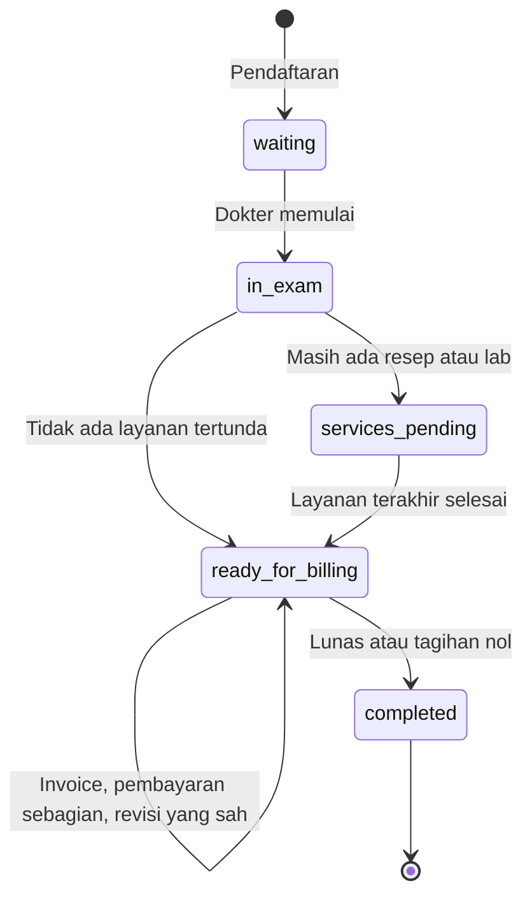

# Alur bisnis dan desain transaksi



## Aturan pelayanan

Pendaftaran menggunakan tanggal server Asia/Jakarta, jadwal aktif sesuai hari, dokter dan poli. Antrean meningkat per poli/tanggal. Satu kunjungan per pasien/poli/hari adalah kebijakan MVP. Booking masa depan, pembatalan dan kunjungan ulang hari sama tidak dimodelkan. Dokter yang ditugaskan mengisi keluhan, anamnesis, pemeriksaan fisik, diagnosis utama dan diagnosis sekunder, serta enam field vital: systolic/diastolic (mmHg), pulse (bpm), temperature (C), respiratory_rate (/menit), weight (kg). Validasi bukan diagnosis otomatis. Versi record mencegah penimpaan diam-diam.

Lima langkah UI: rekam medis, tindakan, resep, lab, review dan selesai. Tindakan/resep/lab opsional. Harga dan nama disalin saat item dibuat; perubahan kuantitas mempertahankan snapshot. Draft resep hanya sebelum pemeriksaan selesai; lab terkunci setelah hasil pertama. Farmasi menyerahkan setelah pemeriksaan selesai. Lab boleh mencatat hasil saat in_exam maupun services_pending. Perubahan section yang sudah disimpan wajib alasan, termasuk setelah daftar dikosongkan; simpan pertama tidak wajib alasan. Pemeriksaan selesai membutuhkan rekam medis lengkap; bila layanan tertunda masuk services_pending, setelah semuanya selesai masuk ready_for_billing. Hasil lab yang sudah final tidak dapat dikoreksi pada MVP.

Invoice otomatis saat siap pembayaran: biaya pendaftaran, tindakan, obat diserahkan, lab selesai. Sumber item sesuai kategori, pasangan kategori/sumber unik. Total bigint = jumlah tarif × kuantitas. Invoice unik per kunjungan. Total nol langsung selesai tanpa pembayaran. Pembayaran sebagian tetap siap pembayaran; lunas menutup kunjungan. Tolak nominal tidak positif atau melebihi saldo. Tidak ada gateway, refund, maupun uang kembalian otomatis. Diagnosis dapat dikoreksi setelah lunas dengan versi/alasan dan audit; revisi tindakan hanya sebelum pembayaran pertama. Riwayat harga dan transaksi tetap ada walaupun master dinonaktifkan.

## D1 — Pendaftaran bersamaan

Yii memulai transaksi, mengambil shared master advisory lock `pg_advisory_xact_lock_shared(682361,1)`, memvalidasi pasien/jadwal, menaikkan counter dan menyimpan kunjungan beserta snapshot dan audit. Mutasi master memakai exclusive lock pada key yang sama. Counter dan insert kunjungan rollback bersama jika gagal. Constraint pasien/poli/tanggal mencegah duplikasi, constraint poli/tanggal/nomor mencegah benturan antrean.

```sql
INSERT INTO queue_counters (clinic_id, visit_date, last_number)
VALUES (:clinic, :date, 1)
ON CONFLICT (clinic_id, visit_date) DO UPDATE
SET last_number = queue_counters.last_number + 1
RETURNING last_number;
```

`ON CONFLICT(patient_id,clinic_id,visit_date) DO NOTHING RETURNING id` membedakan duplicate visit; SQLSTATE 23505 benturan antrean diterjemahkan ke 409. Retry maksimal dua kali untuk 40001/40P01, lalu 503. Mulai pemeriksaan mengunci kunjungan; replay in_exam tanpa efek samping.

## D2 — Stok bersamaan

Urutan lock: shared master guard → kunjungan → obat menurut ID menaik. Stok saat resep dibuat bukan reservasi. Penyerahan mengunci kunjungan dan memeriksa status; update kondisional per obat dan satu movement per item. Jika satu obat tidak cukup, semua update, movement dan status rollback.

```sql
UPDATE medicines SET stock = stock - :qty
WHERE id = :id AND stock >= :qty RETURNING stock;
```

Replay resep yang sudah diserahkan tidak mengurangi stok lagi. CHECK stok nonnegatif dan unique movement melindungi tambahan. Penyesuaian stok admin menggunakan UUID, delta dan alasan; ledger `stock_adjustment_requests` mengikat satu key ke satu movement. Replay mengembalikan saldo terkini, bukan saldo historis.

## D3 — Pembayaran idempotent

Klien membuat UUID untuk satu niat pembayaran, mempertahankan key/body hingga hasil pasti. Yii mengunci kunjungan lalu invoice, memeriksa key sebelum saldo/revisi; fingerprint canonical mengikat invoice, aktor, amount, method, revision dan visit. Key sama dan payload sama mengembalikan kuitansi asli; berbeda 409. Advisory lock key serta constraint unik melindungi lintas invoice. Key baru wajib revisi terkini, status siap dan saldo mencukupi. Pembayaran, audit dan penyelesaian kunjungan commit bersama. UUID tidak mencegah dua niat berbeda; rekonsiliasi riwayat sebelum membuat key baru. Retry UI disimpan di sessionStorage per tab tanpa bearer token.

## D4 — Revisi setelah invoice

Kunci kunjungan lalu invoice; periksa pembayaran pada lock yang sama. Revisi tindakan dan rebuild item/total/revision serta audit atomik; jika total menjadi nol, kunjungan selesai. Snapshot lama dipertahankan untuk baris yang masih ada; revisi identik tidak menaikkan revisi invoice. Perubahan biaya setelah pembayaran pertama ditolak `BILLING_LOCKED`. Kasir dengan revisi lama mendapat `STALE_INVOICE`. Koreksi diagnosis saja tidak mengubah biaya. Versi klinis bersama dan alasan perubahan melindungi riwayat.

## D5 — Gangguan integrasi

Node memvalidasi dan meneruskan event key dan bearer asli. Yii mengunci event key sebelum visit, memeriksa ledger/fingerprint, menyimpan hasil, audit dan status atomik. Replay event diterima mengembalikan snapshot kini; event berbeda pada item final ditolak. Timeout 503 berarti hasil belum pasti; ulang key/body sama atau gunakan fallback Core eksplisit. Dashboard error jika Node mati, bukan nol palsu. Pengirim wajib menyimpan event sendiri; tidak ada distributed write transaction atau antrean offline durable.

## D6 — Performa

Pagination server default 20/maksimal 100, sort stabil, indeks tanggal/poli/dokter, riwayat, pembayaran dan stok. Query contains belum tentu memakai indeks prefix; ukur sebelum menambah trigram. Hindari N+1 dengan join/agregasi. Reporting menggunakan view dan snapshot read-only repeatable read, filter waktu setengah terbuka tanpa cast kolom timestamp. Hasil EXPLAIN ANALYZE pada dataset dummy tercatat dalam [log QA](evidence/automated-qa/runtime-excerpts.txt), tidak mewakili beban produksi.

## Aturan transaksi dan audit bersama

Shared master guard sebelum visit lock, event lab sebelum visit, payment-key lock setelah visit/invoice, obat urut ID. Tidak ada panggilan HTTP eksternal sambil memegang lock DB. Harga, jumlah, aktor dan status diverifikasi server. Audit perubahan klinis, tindakan, stok, invoice dan pengguna dilakukan dalam transaksi yang sama; data sensitif tidak diekspos lewat API audit. Request ID untuk korelasi, domain error konsisten, validasi scope sebelum membaca/mengubah.
